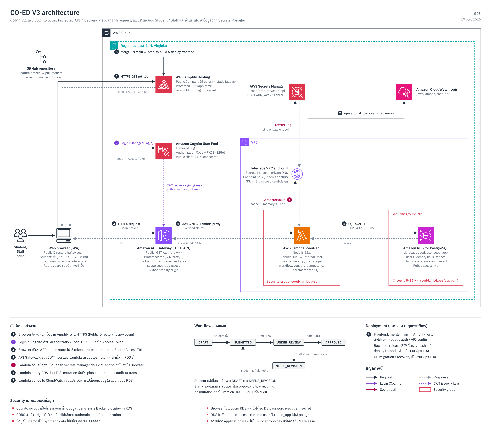

# CO-ED V3 — ระบบข้อมูลและวางแผนสหกิจศึกษา

ระบบสำหรับนักศึกษาเตรียมแผนสหกิจ เจ้าหน้าที่ตรวจคุณสมบัติและมอบหมายอาจารย์ที่ปรึกษา และอาจารย์เปิดอ่านข้อมูลนักศึกษาที่อยู่ในการดูแล พัฒนาต่อจากเว็บไซต์ข้อมูลสาธารณะและ Company Directory ของ V1/V2

V3 เก็บ source code และข้อจำกัดของระบบไว้เป็นฐานสำหรับพัฒนารุ่นถัดไป การออก tag `v3.0.0` ไม่ได้เป็นการ deploy และไม่ได้หมายความว่า workflow ทุกส่วนผ่านการตรวจรับบน AWS แล้ว สถานะการออกรุ่นติดตามใน [Issue #86](https://github.com/zero-h0ur/CS361_G03_Cooperative-Education-Planning-Management-System-/issues/86)

## เว็บไซต์และสถานะการใช้งาน

- [เว็บไซต์](https://main.d1d9qrqnsi5nl6.amplifyapp.com/)
- [ค้นหาสถานประกอบการ](https://main.d1d9qrqnsi5nl6.amplifyapp.com/company-directory.html)
- [พื้นที่ผู้ใช้งาน](https://main.d1d9qrqnsi5nl6.amplifyapp.com/app.html) — ต้องเข้าสู่ระบบ

เว็บไซต์ใน Learner Lab กับ source รุ่นนี้เป็นคนละสถานะกัน:

| ส่วน | สถานะ |
| --- | --- |
| Source code | มี workflow ตรวจคุณสมบัติ ข้อกำหนดเอกสาร Assignment, Placement และพื้นที่ Admin ตามขอบเขตด้านล่าง |
| Frontend ใน Learner Lab | ณ 31 ต.ค. 2569 ใช้ Amplify job `63` ที่สำเร็จจาก commit `e0630172b7aecacd986ada0ae71d3d7f16cf2d17`; ปิด auto-build ของ `main` แล้ว การ merge ต่อจากนี้ไม่อัปเดตเว็บโดยอัตโนมัติ |
| Backend และฐานข้อมูล | การ rollout workflow ใหม่ยังไม่ครบ ต้องตรวจและ apply migration `004–008`, runtime grants, API routes และ Backend ที่เข้ากันได้ก่อนทดสอบครบทุกขั้น |
| ผลตรวจรับเดิม | [Issue #84](https://github.com/zero-h0ur/CS361_G03_Cooperative-Education-Planning-Management-System-/issues/84#issuecomment-6293912895) บันทึกผลวันที่ 20 ต.ค. 2569 ตามขอบเขตและ commit ที่ระบุไว้ ไม่ครอบคลุม workflow ที่เพิ่มภายหลัง |

ข้อมูลนักศึกษาและบัญชีสาธิตเป็นข้อมูลจำลอง ส่วนข้อมูลสถานประกอบการนำเข้าจากชุดข้อมูลที่ตรวจทานแล้ว โดยไม่เผยแพร่ชื่อผู้ติดต่อ อีเมล และเบอร์โทรของตัวแทนบริษัท ระบบยังไม่พร้อมรับข้อมูลนักศึกษาจริง

## ขอบเขตของ source V3

| ผู้ใช้ | การใช้งาน |
| --- | --- |
| Public | ค้นหาและดูชื่อ ที่ตั้ง และโลโก้บริษัทได้ รายละเอียดตำแหน่งและประกาศจริงต้องเข้าสู่ระบบ ไม่มีสิทธิ์เข้าถึงข้อมูลนักศึกษาหรือแผน |
| Student | ดูข้อมูลของตน แก้ที่อยู่และเบอร์โทร สร้างและแก้แผน ส่งตรวจ ดูผลและประวัติ ยกเลิกได้เฉพาะ DRAFT ข้อมูลทะเบียนเป็นแบบอ่านอย่างเดียว |
| Staff | ค้นหาและตรวจแผนในขอบเขตภาควิชา/หลักสูตร/ปีการศึกษาที่รับผิดชอบ กำหนดเอกสาร ส่งกลับแก้ไข อนุมัติหรือปฏิเสธ มอบหมาย Advisor และบันทึกผลยืนยันจากบริษัท |
| Advisor | อ่านข้อมูลนักศึกษาและแผนเฉพาะรายที่ได้รับมอบหมาย ไม่มีสิทธิ์แก้ไข ส่งแผน หรือตรวจอนุมัติ ทั้งหน้าเว็บและ API |
| Admin | ดู metadata บัญชี สถานะ migration และจำนวนข้อมูลหลัก การเปลี่ยน role/สถานะบัญชีใช้ช่องทาง Ops แยก ไม่อนุมัติ ปฏิเสธ หรือมอบหมาย Advisor แทน Staff |

ทุกบัญชีต้องเชื่อม Cognito identity กับผู้ใช้ภายใน RDS บัญชีที่ Login ผ่านแต่ยังไม่ได้เชื่อมสิทธิ์จะใช้พื้นที่ดังกล่าวไม่ได้ Role จากหน้าเว็บไม่ใช่แหล่งตัดสินสิทธิ์

## ขั้นตอนการใช้แผน

นักศึกษาตรวจข้อมูลของตน เลือกรอบสมัคร ระบุบริษัท ตำแหน่งและ Project ที่สนใจ แล้วส่งแผนพร้อมเลขอ้างอิงหรือลิงก์เอกสารตามข้อกำหนดของ Staff เจ้าหน้าที่ตรวจแผนในขอบเขตที่รับผิดชอบ โดยคิวรอตรวจเรียงตามเวลาส่งแบบเก่าก่อน

```text
DRAFT → SUBMITTED → UNDER_REVIEW → APPROVED
                         ├──────→ REJECTED
                         └──────→ NEEDS_REVISION → SUBMITTED
DRAFT → CANCELLED
```

- `NEEDS_REVISION`: Staff ระบุเหตุผล นักศึกษาเจ้าของแผนแก้แล้วส่งใหม่ได้ แต่ยกเลิกไม่ได้
- `REJECTED`: ไม่ผ่านเกณฑ์ เป็นสถานะสิ้นสุดในรอบนั้น แก้หรือยื่นซ้ำในรอบเดิมไม่ได้
- `CANCELLED`: ยกเลิกแบบเก็บประวัติได้จาก `DRAFT` เท่านั้น ไม่ลบแถวข้อมูลออกจากฐานข้อมูล

เมื่อแผน `APPROVED` แล้ว Staff จึงมอบหมาย Advisor ได้ โดยจำกัดการดูแลพร้อมกันไม่เกิน 5 คนต่อ Advisor ส่วนผลตอบรับบริษัทบันทึกใน Placement แยกจากแผน **ผ่านเกณฑ์สหกิจไม่ได้แปลว่าบริษัทตอบรับแล้ว** Staff ต้องตรวจบริษัทและรหัสนักศึกษาให้ตรงกับหลักฐานที่ได้รับ

Backend ตรวจ role, ownership, scope, state และ version ก่อนเปลี่ยนข้อมูล ใช้ operation ID ป้องกันการทำรายการซ้ำ และบันทึกผลพร้อม audit ใน transaction เดียวกัน

## โครงสร้างระบบ



ภาพวันที่ 19 ต.ค. 2569 แสดงสถาปัตยกรรมพื้นฐาน V3 และเส้นทางคำขอ Student/Staff ไม่ครอบคลุม Assignment, Placement และพื้นที่ Admin ที่เพิ่มภายหลัง รายละเอียดส่วนขยายอยู่ใน [workflow diagram](docs/architecture/G03-V3-workflow.png) ภาพทั้งสองไม่ใช่หลักฐานว่าฟีเจอร์ทุกส่วนขึ้นระบบจริงแล้ว

Frontend อยู่บน Amplify Hosting และเข้าสู่ระบบผ่าน Cognito แบบ Authorization Code + PKCE ส่วน API ใช้ API Gateway, Lambda และ RDS PostgreSQL ที่ไม่เปิด public access เส้นทางข้อมูลนักศึกษาและแผนต้องผ่าน JWT authorizer และการตรวจ role/ownership/scope ใน backend อีกชั้นหนึ่ง

Lambda อ่านรหัสผ่านฐานข้อมูลจาก Secrets Manager ผ่าน VPC endpoint เชื่อม RDS ผ่าน TLS และใช้บัญชี runtime `coed_app` ที่จำกัดสิทธิ์ Browser ไม่เชื่อมฐานข้อมูลโดยตรง และไม่ได้รับรหัสฐานข้อมูล ส่วน CloudWatch เก็บ operational logs แยกจาก audit ใน RDS

- [Architecture และเหตุผลการออกแบบ](docs/architecture/G03-V3-architecture.md)
- [API contract หลัก](docs/api/v3-shared-contract.md) และ [workflow contract](docs/api/three-role-workflow.md)
- [คู่มือพัฒนา ดูแลระบบ และงานต่อ V4](docs/operations/v3-operating-guide.md)
- [การทดสอบและ rollout workflow](docs/operations/three-role-workflow.md)
- [สรุปงาน Issue / PR และผลทดสอบ](docs/evidence/v3-delivery-index.md)

## เริ่มพัฒนา

ใช้ Node.js 20+ และ npm:

```bash
npm ci
npm run dev:ui
```

เปิด [Local UI](http://localhost:8081/app.html#/student/plan) เพื่อดูหน้าจอด้วยข้อมูลจำลองใน memory ไม่ต้องใช้ AWS หรือฐานข้อมูล Preview เปลี่ยน role และสถานการณ์เพื่อดูหน้าจอได้ แต่ไม่ใช่การทดสอบ Login หรือสิทธิ์จริง ดูรายละเอียดใน [Local UI Preview](docs/frontend/local-ui-preview.md)

หากต้องใช้ API หรือ PostgreSQL ให้ตั้งฐานข้อมูล development และ test คนละตัวตาม [คู่มือพัฒนา](docs/operations/v3-operating-guide.md) ห้ามใช้ RDS เป็นฐานข้อมูลทดสอบ

```bash
npm run lint
npm run test:frontend
npm run test:ui-preview
npm run test:docs
```

Full regression ใช้ `npm test` หลังตั้งค่าฐานข้อมูลทดสอบที่สร้างทิ้งได้โดยเฉพาะ บาง suite ล้าง fixtures และต้องเปิด reset guard ตามคู่มือ ส่วน integration บางชุดจะรายงาน skipped หากไม่ได้ตั้งฐานข้อมูล การผ่านเฉพาะ unit tests ไม่ได้แทนผล integration

`npm start` เปิด local API แต่ไม่ได้จำลอง trusted claims ของ API Gateway ส่วน frontend ที่ build แล้วอยู่ใน `dist/` การ build ต้องรับค่า `CO_ED_*` ที่เป็น public configuration เท่านั้น ไม่ส่งรหัสผ่านหรือ AWS credentials ไปยัง Browser

## ข้อจำกัดและงานต่อ V4

- Workflow ใหม่ยังไม่ผ่าน deployed acceptance ครบทุก role ก่อนเปิดใช้ต้องตรวจ migration, grants, routes และ Backend/Frontend ที่เข้ากันได้ การ build สำเร็จไม่ยืนยันความพร้อมของฐานข้อมูล
- ข้อมูลทะเบียนเป็นข้อมูลจำลอง ยังไม่ได้เชื่อม TU API และไม่มีระบบประเมิน GPA อัตโนมัติ ไม่มีขั้นตอน Advisor Endorsed หรือบทบาท Coordinator/Committee แยกต่างหาก
- เอกสารเป็นลิงก์หรือเลขอ้างอิงภายนอก ระบบตรวจข้อมูลที่ผู้ใช้ระบุ ไม่ได้อัปโหลด อ่านเนื้อหาไฟล์ หรือจัดการสิทธิ์ของไฟล์จริง
- Logout ล้าง session ข้ามแท็บและเรียกเพิกถอน refresh token แต่ยังไม่รับประกันการปฏิเสธ Access Token เดิมทันทีที่ API; token ที่ตรวจด้วยลายเซ็นอาจใช้ได้จนหมดอายุ
- Admin ยังไม่มีหน้าจัดการบริษัทหรือเปลี่ยนบัญชีผ่านเว็บโดยตรง ไม่มีระบบส่งอีเมล แจ้งเตือน หรือเชื่อมต่อระบบภายนอกอัตโนมัติ
- V4 ต้องทบทวน requirement, workflow และหน้าจอของแต่ละ role ใหม่ ไม่ถือว่ากติกาใน V3 เป็นข้อกำหนดสุดท้าย รายการด้าน deployment, session และ logging อยู่ใน [คู่มือส่งต่อ](docs/operations/v3-operating-guide.md#งานต่อ-v4)

## การส่งงานและรุ่น

ตั้งชื่อ Branch ตามประเภทงาน ได้แก่ `feature/`, `fix/`, `docs/` และ `chore/` ตาม [CONTRIBUTING](CONTRIBUTING.md) จากนั้นเปิด PR เข้า `main` และใส่ `Closes #<issue-number>` เมื่องานครบตาม Issue

| รุ่น | เนื้อหา |
| --- | --- |
| [V1](https://github.com/zero-h0ur/CS361_G03_Cooperative-Education-Planning-Management-System-/tree/v1.0.0) | เว็บไซต์ข้อมูลแบบ static |
| [V2](https://github.com/zero-h0ur/CS361_G03_Cooperative-Education-Planning-Management-System-/tree/v2.0.0) | Company Directory ที่ดึงข้อมูลผ่าน API และ RDS |
| V3 | Source ของ Student/Staff/Advisor workflow และ Admin operations พร้อมข้อจำกัดข้างต้น; งาน `v3.0.0` ติดตามใน [#86](https://github.com/zero-h0ur/CS361_G03_Cooperative-Education-Planning-Management-System-/issues/86) |

เอกสาร V2: [Backend setup](docs/v2-backend-setup.md), [ชุดข้อมูล](docs/data/v2-mock-data.md), [Decisions](docs/decisions/issue-30-decisions.md), [ผลตรวจ](docs/issue-32-manual-verification.md)

## สมาชิก

- นายปพนพัชร์ มีวน 6709650458
- นายภูริณัฐ วรรธนะธัญญา 6709650565
- นายรณกฤต วรลักษณ์ภักดี 6709650607
- นายณัษฐภาคย์ ไกรวิชญ์ชนาพร 6709650334
