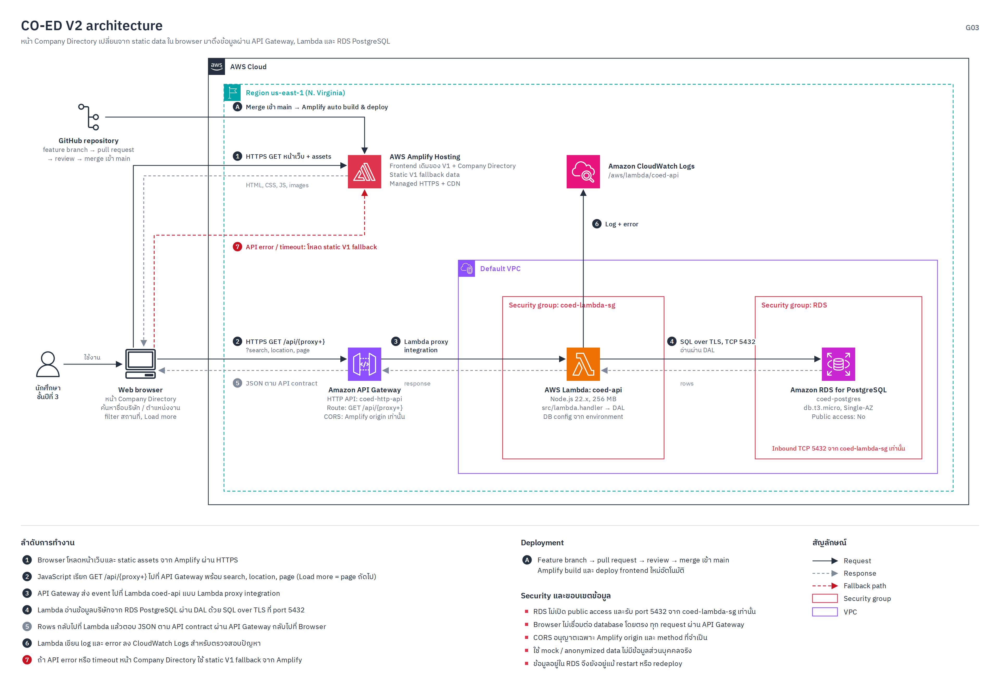

# CO-ED: Cooperative Education Planning and Information System (Version 2)

CO-ED เป็นระบบรวบรวมและให้บริการข้อมูลสำหรับนักศึกษาชั้นปีที่ 3 สาขาวิชาวิทยาการคอมพิวเตอร์ มหาวิทยาลัยธรรมศาสตร์ ที่กำลังเตรียมตัวเข้าร่วมสหกิจศึกษา โดยรวมข้อกำหนด ขั้นตอน กำหนดการ รายชื่อสถานประกอบการ และคำถามที่พบบ่อยไว้ในจุดเดียว

Version 2 พัฒนาต่อจาก Static Website ของ V1 โดยเพิ่ม Public read-only API, Serverless compute และ Persistent relational database สำหรับหน้า Company Directory ขณะที่หน้าและพฤติกรรมหลักของ V1 ยังคงใช้งานได้

- เว็บไซต์ที่ Deploy แล้ว: [CO-ED บน AWS Amplify](https://main.d1d9qrqnsi5nl6.amplifyapp.com/)
- หน้า Company Directory: [รายชื่อสถานประกอบการ](https://main.d1d9qrqnsi5nl6.amplifyapp.com/company-directory.html)
- API Health Check: [GET /api/health](https://qtqlsb1aec.execute-api.us-east-1.amazonaws.com/api/health)
- GitHub Repository: [zero-h0ur/CS361_G03_Cooperative-Education-Planning-Management-System-](https://github.com/zero-h0ur/CS361_G03_Cooperative-Education-Planning-Management-System-)

> ข้อมูลบริษัท ตำแหน่งงาน นักศึกษา แผน และรอบเวลาใน V2 เป็น Mock/Anonymized data สำหรับ Development, Test และ Demo ไม่ใช่ข้อมูลการเปิดรับจริง

## Problem and Primary User

ข้อมูลสำหรับเตรียมสหกิจศึกษาอยู่ในหลายแหล่ง เช่น ประกาศ เอกสาร และช่องทางสื่อสารของสาขาวิชา ทำให้นักศึกษาตรวจสอบข้อมูลและขั้นตอนที่ต้องดำเนินการได้ยาก ผู้ใช้หลักของระบบจึงเป็นนักศึกษาชั้นปีที่ 3 ที่ต้องการค้นหาและตรวจสอบข้อมูลสำคัญจากจุดเดียว

ใน V1 รายชื่อสถานประกอบการเป็น Static data ภายในหน้าเว็บ การปรับปรุงข้อมูลต้องแก้ Source code และ Deploy Frontend ใหม่ ส่วน V2 ย้ายข้อมูลสำหรับ Company Directory ไปยัง PostgreSQL และให้ Browser อ่านผ่าน Public API เพื่อรองรับการค้นหา การกรอง Pagination และการคงอยู่ของข้อมูลหลัง Restart หรือ Redeploy

## V2 Scope

### สิ่งที่ V2 รองรับ

- ใช้งานหน้า Landing page, Requirements, Company Directory และ FAQ จาก V1 ต่อได้
- โหลดรายชื่อสถานประกอบการจาก Dynamic API
- ค้นหาจากชื่อสถานประกอบการหรือชื่อตำแหน่งงาน
- กรองตามสถานที่ของบริษัทหรือตำแหน่งงาน
- แบ่งหน้าข้อมูลและโหลดหน้าถัดไปด้วยปุ่มดูเพิ่มเติม
- แสดงสถานะ Mock/To validate ให้ผู้ใช้ทราบคุณภาพของข้อมูล
- ใช้ Static V1 fallback เมื่อ API, Network หรือ Response contract มีปัญหา
- จัดเก็บข้อมูลใน Amazon RDS for PostgreSQL
- จำกัด Public API ให้เป็น Read-only และส่งเฉพาะ Public fields
- บันทึก Runtime logs ของ Lambda ใน Amazon CloudWatch Logs

### สิ่งที่ยังอยู่นอกขอบเขต V2

- Authentication และ Authorization ของผู้ใช้
- การสมัครสหกิจหรือ Upload เอกสารจริง
- การเพิ่ม แก้ไข หรือลบข้อมูลผ่าน Public API
- Workflow การอนุมัติแผนและติดตามสถานะรายบุคคล
- ระบบหลังบ้านสำหรับอาจารย์หรือเจ้าหน้าที่
- การใช้ข้อมูลนักศึกษาหรือข้อมูลสถานประกอบการจริงใน Production

## Architecture

### Version 3 security architecture and decision baseline

เอกสาร [V3 architecture, trust boundaries และ privacy baseline](docs/architecture/G03-V3-architecture.md)
สรุป component/data flow, server-side enforcement points, audit path, V3 scope และ
Accepted Decisions D01-D08 สำหรับงาน V3 ที่กำลังพัฒนา โดยไม่เปลี่ยน Public V2
Company Directory ที่ใช้งานอยู่

### Detailed Architecture and Request Flow

[](docs/architecture/G03-V2-architecture-full.png)

แผนภาพนี้แสดง Runtime flow, Deployment flow, VPC, Security Groups, CORS, TLS, CloudWatch Logs และ Static fallback ของ V1

### AWS Cloud Architecture Overview

[](docs/architecture/G03-V2-architecture.drawio.png)

ไฟล์ Overview นี้ Export จาก Draw.io พร้อมฝังข้อมูล Diagram จึงสามารถนำไฟล์ PNG กลับไปเปิดและแก้ไขใน Draw.io ได้

### Runtime Flow

```text
ผู้ใช้
  │
  ▼
Web Browser ── HTTPS: HTML/CSS/JavaScript/Images ──> AWS Amplify Hosting
  │
  └── HTTPS: GET /api/* ──> Amazon API Gateway HTTP API
                                  │
                                  ▼
                             AWS Lambda
                                  │
                                  │ SQL over TLS: TCP 5432
                                  ▼
                         Amazon RDS for PostgreSQL
```

1. Browser โหลด Frontend และ Static assets จาก AWS Amplify ผ่าน HTTPS
2. JavaScript ใน Browser เรียก API Gateway โดยตรง พร้อมเงื่อนไข `q`, `location`, `page` และ `pageSize`
3. API Gateway จัดการ Route/CORS แล้ว Invoke Lambda ด้วย Lambda proxy integration
4. Lambda ตรวจสอบ Input และเรียก Data Access Layer (DAL)
5. DAL ส่ง Parameterized SQL ผ่าน TLS ไปยัง RDS for PostgreSQL
6. PostgreSQL เป็นส่วนที่ค้นหา กรอง เรียง และแบ่งหน้าข้อมูลจริง
7. ผลลัพธ์ย้อนกลับเป็น JSON ผ่าน Lambda และ API Gateway ไปยัง Browser
8. Lambda ส่ง Log และ Error ไปยัง CloudWatch Logs
9. หาก Dynamic API ใช้งานไม่ได้ หน้า Company Directory จะใช้ Static fallback ของ V1

### AWS Components

| Component | Service / Technology | Responsibility |
| --- | --- | --- |
| Client | Web Browser | แสดงหน้าเว็บ รับเงื่อนไขค้นหา เรียก API และ Render ผลลัพธ์ |
| Frontend Hosting | AWS Amplify Hosting | ให้บริการ Static assets ผ่าน HTTPS/CDN และ Deploy จาก GitHub `main` |
| Public API | Amazon API Gateway HTTP API | ให้ HTTPS endpoint, Route, CORS และ Invoke Lambda |
| Compute | AWS Lambda, Node.js 22.x | รัน API routing, validation และ DAL |
| Database | Amazon RDS for PostgreSQL | เก็บ Persistent relational data และประมวลผล Query |
| Network | Amazon VPC และ Security Groups | จำกัด RDS Port 5432 ให้เข้าถึงจาก Lambda Security Group เท่านั้น |
| Observability | Amazon CloudWatch Logs | เก็บ Lambda runtime logs, errors, duration และ Request ID |
| Source and Delivery | GitHub และ AWS Amplify | Branch, Pull Request, Review, Merge และ Automatic frontend deployment |

### Security and Data Boundary

- Frontend และ API แยกกันคนละ Origin โดย CORS อนุญาตเฉพาะ Amplify origin ของทีม
- CORS เป็น Browser policy ไม่ใช่ Authentication ดังนั้น API จึงเปิดเฉพาะข้อมูล Public และ Read-only operations
- RDS ปิด Public access และรับ TCP 5432 จาก `coed-lambda-sg` เท่านั้น
- Browser ไม่สามารถติดต่อ Database โดยตรง ทุก Request ต้องผ่าน API Gateway และ Lambda
- การเชื่อมต่อจาก Lambda ไป RDS ใช้ TLS และตรวจ Certificate ด้วย RDS CA bundle
- API ใช้ Public-field allowlist และไม่เปิด Endpoint สำหรับ Student หรือ Plan
- Configuration แยกจาก Source code ผ่าน Environment variables และไม่ Commit Credential ลง Repository

## Design Decisions

### ใช้ Amplify เดิมสำหรับ Frontend

V1 Deploy บน Amplify อยู่แล้ว ทีมจึงคง Hosting, HTTPS, CDN และ Automatic deployment เดิมไว้ ลดผลกระทบต่อหน้าเว็บและ URL ที่ผู้ใช้ใช้งานอยู่

### แยก Frontend กับ API คนละ Origin

Browser โหลดหน้าเว็บจาก Amplify แต่เรียก Dynamic API ที่ API Gateway โดยตรง ทำให้ Frontend และ Backend Deploy แยกจากกันได้ และควบคุม Browser access ผ่าน CORS

### ใช้ API Gateway HTTP API และ Lambda

V2 เป็น Public read-only API ที่มี Traffic ระดับงานนักศึกษา จึงไม่จำเป็นต้องเปิด Server ตลอดเวลา API Gateway ให้ Public HTTPS endpoint ส่วน Lambda ทำงานเมื่อมี Request และไม่ต้องดูแล Operating system หรือ Web Server

### ใช้ PostgreSQL

ข้อมูล V2 มีความสัมพันธ์ระหว่าง Company, Position, Student, Plan และ Round จึงใช้ PostgreSQL เพื่อรองรับ Primary key, Foreign key, Constraints, Indexes, Search และ Pagination รวมถึงรักษาข้อมูลไว้หลัง Restart หรือ Redeploy

### ใช้ Data Access Layer

DAL แยก SQL และ Database error handling ออกจาก API handler ทำให้ทดสอบ Database logic แยกได้ ลด Query ซ้ำ และควบคุมการอ่านเฉพาะ Public records จากจุดเดียว

### คง Static fallback ของ V1

หาก API, Network หรือ Response contract มีปัญหา หน้า Company Directory ยังแสดงข้อมูลตัวอย่างเดิมได้แทนหน้าว่าง โดยจะแจ้งสถานะให้ผู้ใช้ทราบว่าไม่ได้ใช้ข้อมูลล่าสุด

## Public API

Base URL:

```text
https://qtqlsb1aec.execute-api.us-east-1.amazonaws.com
```

| Method | Endpoint | รายละเอียด |
| --- | --- | --- |
| GET | `/api/health` | ตรวจสอบว่า API และ Lambda ตอบสนองได้ |
| GET | `/api/companies?q=&location=&page=&pageSize=` | แสดง ค้นหา กรอง และแบ่งหน้ารายชื่อบริษัท |
| GET | `/api/companies/:companyId` | อ่านบริษัท Public ตาม UUID |
| GET | `/api/companies/:companyId/positions` | อ่านตำแหน่งงาน Public ของบริษัท |
| GET | `/api/positions/:positionId` | อ่านตำแหน่งงาน Public ตาม UUID |

ตัวอย่าง:

```bash
curl "https://qtqlsb1aec.execute-api.us-east-1.amazonaws.com/api/companies?q=Cloud&location=นนทบุรี&page=1&pageSize=10"
```

API รองรับเฉพาะ `GET` หากใช้ Method อื่นจะตอบ `405 Method Not Allowed` และ Query parameters ที่ไม่รองรับจะตอบ `400 Bad Request`

## Data Model

ตารางหลักของ V2 ได้แก่:

| Table | หน้าที่ | ความสัมพันธ์สำคัญ |
| --- | --- | --- |
| `companies` | ข้อมูลสถานประกอบการ | `id` เป็น UUID Primary key |
| `positions` | ตำแหน่งงาน | `company_id` เป็น Foreign key ไป `companies.id` |
| `rounds` | รอบและปีการศึกษา | ถูกอ้างถึงจาก `plans.round_id` |
| `document_metadata` | Metadata ของเอกสารสาธารณะ | ไม่มีข้อมูลไฟล์ส่วนบุคคล |
| `students` | นักศึกษาสมมติ | `anonymous_ref` เป็น Unique และข้อมูลเป็น Private |
| `plans` | แผนสหกิจสมมติ | Foreign key ไป `students.id` และ `rounds.id` |

`Company.location` และ `Position.location` เป็น Text attributes ใน V2 ยังไม่มีตาราง Location หรือ Location foreign key แยก การกรองสถานที่จะตรวจทั้ง Location ของบริษัทและของตำแหน่งงาน

อ่าน Schema ได้ที่ [`src/db/migrations/001_initial_schema.sql`](src/db/migrations/001_initial_schema.sql) และอ่านกติกาของ Dataset ได้ที่ [`docs/data/v2-mock-data.md`](docs/data/v2-mock-data.md)

## Project Structure

```text
.
├── index.html
├── requirements.html
├── company-directory.html
├── company-directory.js
├── company-directory-helpers.js
├── runtime-config.js
├── faq.html
├── style.css
├── data/v2/
│   └── mock-dataset.json
├── src/
│   ├── lambda.js
│   ├── server.js
│   ├── api/app.js
│   └── db/
│       ├── connection.js
│       ├── dal.js
│       ├── migrate.js
│       ├── seed.js
│       └── migrations/001_initial_schema.sql
├── tests/
│   ├── api.test.js
│   ├── company-directory.test.js
│   ├── dal.test.js
│   ├── lambda.test.js
│   └── v2-dataset.test.mjs
├── docs/
│   ├── architecture/
│   │   ├── G03-V1-architecture.png
│   │   ├── G03-V2-architecture-full.png
│   │   └── G03-V2-architecture.drawio.png
│   ├── data/v2-mock-data.md
│   ├── decisions/issue-30-decisions.md
│   ├── issue-32-manual-verification.md
│   └── v2-backend-setup.md
├── CONTRIBUTING.md
└── README.md
```

## Run Locally

### Prerequisites

- Node.js 18.14 ขึ้นไป
- npm
- Docker สำหรับ Local PostgreSQL

### 1. ติดตั้ง Dependencies

```bash
npm ci
```

### 2. เริ่ม Local PostgreSQL

```bash
docker run --name pg-v2 \
  -e POSTGRES_PASSWORD=postgres \
  -e POSTGRES_DB=coed_v2 \
  -p 5432:5432 \
  -d postgres:16-alpine

docker exec pg-v2 psql -U postgres \
  -c "CREATE DATABASE coed_v2_test;"
```

### 3. ตั้งค่า Environment

```bash
cp .env.example .env
```

ตรวจสอบว่า `DATABASE_URL` ชี้ไป Development database และ `TEST_DATABASE_URL` ชี้ไป Test database คนละตัวกัน ห้าม Commit ไฟล์ `.env`

### 4. Migration และ Seed

```bash
NODE_ENV=development ALLOW_DB_RESET=true npm run seed
```

> คำเตือน: Seed script ลบและเขียนข้อมูลใน Database เป้าหมายใหม่ ห้ามรันกับ Production database

### 5. เริ่ม Local API

```bash
npm start
```

API จะทำงานที่ `http://localhost:3000` โดยค่าเริ่มต้น รายละเอียดเพิ่มเติมอยู่ใน [`docs/v2-backend-setup.md`](docs/v2-backend-setup.md)

### 6. เปิด Frontend

```bash
python3 -m http.server 8000
```

จากนั้นเปิด [http://localhost:8000](http://localhost:8000)

`runtime-config.js` กำหนด API Base URL ที่ Frontend ใช้ หากต้องการทดสอบกับ Local API ให้ Override `window.CO_ED_CONFIG.apiBaseUrl` เป็น `http://localhost:3000` ใน Environment สำหรับทดสอบ และอย่า Commit ค่า Local ทับ Production configuration

## Tests

รัน Test ทั้งหมดด้วย:

```bash
NODE_ENV=test ALLOW_DB_RESET=true npm test
```

Test suites ครอบคลุม:

- Dataset metadata, relationships และ data-safety rules
- API routes, validation, status codes และ public-field contract
- Lambda event/response adapter
- Frontend query parameters, search/filter reset, pagination, stale responses และ Static fallback
- DAL migration, seed, constraints, search, location filter และ pagination กับ PostgreSQL แยกสำหรับ Test

สามารถรันแยกได้ด้วย:

```bash
npm run test:dataset
npm run test:api
npm run test:lambda
npm run test:frontend
npm run test:dal
```

## Deployment

### Frontend

```text
Feature branch → Pull Request → Review → Merge เข้า main
              → AWS Amplify build และ deploy อัตโนมัติ
```

### Backend

- Package Application code, Dependencies และ RDS CA bundle เป็น Lambda ZIP
- Deploy ไปยัง Lambda Function `coed-api`
- Runtime: Node.js 22.x
- Handler: `src/lambda.handler`
- API Gateway Route: `GET /api/{proxy+}`
- Lambda เชื่อม RDS ผ่าน VPC และ Security Groups
- Runtime configuration เก็บใน Lambda Environment variables

## Version History and Git Tags

ทีมใช้ Annotated Git tags เพื่อเก็บจุดสิ้นสุดของแต่ละ Milestone:

| Version | Tag | เนื้อหาหลัก |
| --- | --- | --- |
| Version 1 | `v1.0.0` | Static website บน Amplify และ Client-side search |
| Version 2 | `v2.0.0` | Dynamic Company Directory, API Gateway, Lambda และ RDS PostgreSQL |

Tag เก็บ Snapshot ของ Source code, README และ Architecture ของ Version นั้นทั้งหมด ดังนั้นแม้ README บน `main` จะเปลี่ยนเป็น V3 ในอนาคต README ของ V1 และ V2 จะยังเปิดดูจาก Tag เดิมได้

ตัวอย่างการกลับไปดู Version เก่าโดยไม่แก้ Branch ปัจจุบัน:

```bash
git fetch --tags
git switch --detach v1.0.0

# กลับ Branch หลัก
git switch main
```

หากต้องการพัฒนาต่อจาก Version เก่า ให้สร้าง Branch ใหม่จาก Tag แทนการ Commit บน Detached HEAD:

```bash
git switch -c investigate-v1 v1.0.0
```

## Verification Checklist

1. เปิดหน้า Company Directory แล้วตรวจว่าโหลดข้อมูล 10 รายการแรกจาก API
2. ค้นหาด้วยชื่อบริษัทและชื่อตำแหน่งงาน
3. กรองตามสถานที่และตรวจจำนวนผลลัพธ์
4. กดดูเพิ่มเติมและตรวจว่าไม่มี Company ซ้ำ
5. ทดสอบคำค้นหาที่ไม่พบข้อมูลและตรวจ Empty state
6. เปิด Health endpoint และตรวจ HTTP `200`
7. ตรวจ Network tab ว่า `/api/companies` ตอบ `200`
8. ตรวจ CloudWatch Logs เมื่อเรียก Lambda
9. ทดสอบ Static fallback เมื่อ API ใช้งานไม่ได้
10. รัน Automated tests กับ Test database แยกจาก Development/Production

## Engineering Evidence

V2 ถูกพัฒนาผ่าน Issues, Feature branches, Pull Requests และ Reviews โดยหลักฐานสำคัญประกอบด้วย:

- Mock/Anonymized dataset และ Data-quality tests
- PostgreSQL migrations, seed และ Data Access Layer tests
- Public read-only API และ API contract tests
- Dynamic Company Directory และ Frontend behavior tests
- Static fallback และ Manual verification checklist
- AWS deployment, Network response และ Lambda execution evidence

เอกสารเพิ่มเติม:

- [V2 Backend Setup](docs/v2-backend-setup.md)
- [V2 Mock Dataset](docs/data/v2-mock-data.md)
- [Data Access Layer Decisions](docs/decisions/issue-30-decisions.md)
- [Company Directory Manual Verification](docs/issue-32-manual-verification.md)
- [Contribution Workflow](CONTRIBUTING.md)

## Team Members

- นายปพนพัชร์ มีวน 6709650458
- นายภูริณัฐ วรรธนะธัญญา 6709650565
- นายรณกฤต วรลักษณ์ภักดี 6709650607
- นายณัษฐภาคย์ ไกรวิชญ์ชนาพร 6709650334
