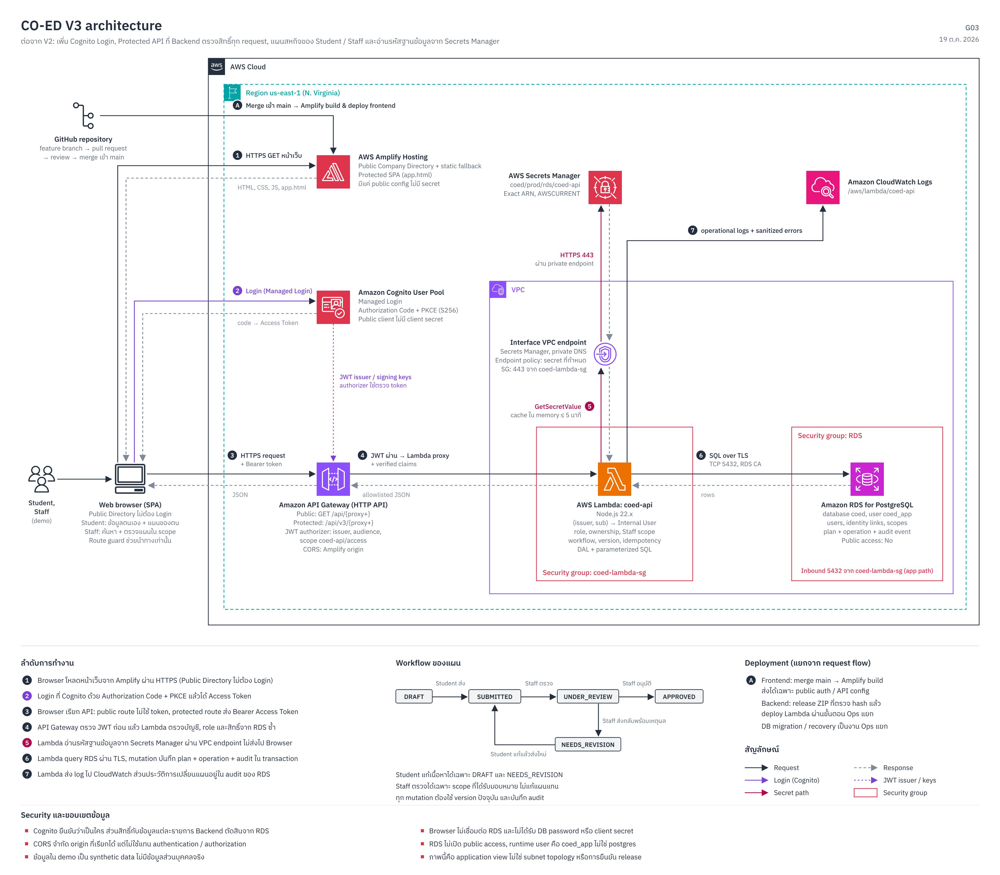

# CO-ED V4 — Planning, Tracking & Reliability

ระบบข้อมูลและวางแผนสหกิจศึกษา ย้ายจาก AWS Learner Lab มายังบัญชีใหม่เป็นฐานพัฒนา V4 โดยเก็บ workflow เดิมและเพิ่ม Coordinator/Committee แยกบทบาท กติกาธุรกิจและรายละเอียดหน้าจอยังต้องให้เจ้าของโครงการกับทีมยืนยันร่วมกัน

งานรุ่นนี้ติดตามใน [Milestone V4](https://github.com/zero-h0ur/CS361_G03_Cooperative-Education-Planning-Management-System-/milestone/4) และงานจัดฐานโค้ดใน [Issue #139](https://github.com/zero-h0ur/CS361_G03_Cooperative-Education-Planning-Management-System-/issues/139) การย้ายระบบและการทดสอบเส้นทางจำลองยังไม่ใช่การตรวจรับฟีเจอร์ V4 ทั้งหมด ประวัติ source V3 อยู่ที่ [Issue #86](https://github.com/zero-h0ur/CS361_G03_Cooperative-Education-Planning-Management-System-/issues/86)

## เว็บไซต์และสถานะการใช้งาน

- [เว็บไซต์](https://main.d1bpmj87vmjb96.amplifyapp.com/)
- [ค้นหาสถานประกอบการ](https://main.d1bpmj87vmjb96.amplifyapp.com/company-directory.html)
- [พื้นที่ผู้ใช้งาน](https://main.d1bpmj87vmjb96.amplifyapp.com/app.html) — ต้องเข้าสู่ระบบ

ฐานระบบใหม่ ณ 1 พ.ย. 2569:

| ส่วน | สถานะ |
| --- | --- |
| บัญชี / Region | `130165494095 / ap-southeast-2` (Sydney), ย้ายจาก Lab `676101350279 / us-east-1` |
| Frontend | Amplify job `3` สำเร็จ, Manual Deploy และ Auto-build ปิดอยู่; Merge ไม่เผยแพร่เว็บโดยอัตโนมัติ |
| Backend / DB | Lambda `coed-api`, API Gateway JWT และ Cognito ใหม่; RDS PostgreSQL `16.15`, migrations `001–009` และ runtime grants นำขึ้นแล้ว |
| ข้อมูลและการทดสอบ | Restore ข้อมูลเดิมและเชื่อมตัวตนใหม่; ผู้ใช้ยืนยัน Login ครบห้าบัญชีและ flow จำลองถึงกรรมการครบ `3/3` โดยยังรอประกาศผล |
| ระบบ Lab เดิม | ยังไม่ปิดทั้งหมด ติดตามการเลิกใช้ใน [#148](https://github.com/zero-h0ur/CS361_G03_Cooperative-Education-Planning-Management-System-/issues/148) |

รายละเอียดทรัพยากร ขอบเขตการย้าย วิธี Build/Deploy และเงื่อนไขก่อน Merge อยู่ใน [ฐาน V4](docs/operations/v4-baseline.md) และ [หลักฐานการย้าย/ทดสอบ](docs/evidence/v4-migration-baseline.md) เอกสาร V3 เก็บเป็นประวัติและอาจมี URL/คำสั่ง Lab เดิม ไม่ใช่คู่มือ Deploy บัญชีใหม่

ข้อมูลนักศึกษาและบัญชีสาธิตเป็นข้อมูลจำลอง ส่วนข้อมูลสถานประกอบการนำเข้าจากชุดข้อมูลที่ตรวจทานแล้ว โดยไม่เผยแพร่ชื่อผู้ติดต่อ อีเมล และเบอร์โทรของตัวแทนบริษัท ระบบยังไม่พร้อมรับข้อมูลนักศึกษาจริง

## ขอบเขตของ source ปัจจุบัน

| ผู้ใช้ | การใช้งาน |
| --- | --- |
| Public | ค้นหาและดูชื่อ ที่ตั้ง และโลโก้บริษัทได้ รายละเอียดตำแหน่งและประกาศจริงต้องเข้าสู่ระบบ ไม่มีสิทธิ์เข้าถึงข้อมูลนักศึกษาหรือแผน |
| Student | ดูข้อมูลของตน แก้ที่อยู่และเบอร์โทร สร้างและแก้แผน ส่งตรวจ ดูผลและประวัติ ยกเลิกได้เฉพาะ DRAFT ข้อมูลทะเบียนเป็นแบบอ่านอย่างเดียว |
| Staff | ค้นหาและตรวจแผนในขอบเขตภาควิชา/หลักสูตร/ปีการศึกษาที่รับผิดชอบ กำหนดเอกสาร ส่งกลับแก้ไข อนุมัติหรือปฏิเสธ มอบหมาย Advisor และบันทึกผลยืนยันจากบริษัท |
| Advisor | อ่านข้อมูลนักศึกษาและแผนเฉพาะรายที่ได้รับมอบหมาย ไม่มีสิทธิ์แก้ไข ส่งแผน หรือตรวจอนุมัติ ทั้งหน้าเว็บและ API |
| Admin | ดู metadata บัญชี สถานะ migration และจำนวนข้อมูลหลัก การเปลี่ยน role/สถานะบัญชีใช้ช่องทาง Ops แยก ไม่อนุมัติ ปฏิเสธ หรือมอบหมาย Advisor แทน Staff |
| Coordinator | รับเรื่องเฉพาะรอบ/หลักสูตรที่ได้รับมอบหมาย และส่งต่อกรรมการ โดยไม่อนุมัติผลแทนกรรมการ |
| Committee | บันทึกความเห็นแยกกันสามคนต่อผู้สมัคร เห็นเฉพาะความเห็นของตน ครบสามคนแล้วยังรอประกาศผล |

ทุกบัญชีต้องเชื่อม Cognito identity กับผู้ใช้ภายใน RDS บัญชีที่ Login ผ่านแต่ยังไม่ได้เชื่อมสิทธิ์จะใช้พื้นที่ดังกล่าวไม่ได้ Role จากหน้าเว็บไม่ใช่แหล่งตัดสินสิทธิ์

## ขั้นตอนการใช้แผน

นักศึกษาตรวจข้อมูลของตน เลือกรอบสมัคร ระบุบริษัท ตำแหน่งและ Project ที่สนใจ แล้วส่งแผนพร้อมเลขอ้างอิงหรือลิงก์เอกสารตามข้อกำหนดของ Staff เจ้าหน้าที่ตรวจแผนในขอบเขตที่รับผิดชอบ โดยคิวรอตรวจเรียงตามเวลาส่งแบบเก่าก่อน

```text
DRAFT → SUBMITTED → UNDER_REVIEW → APPROVED
                         ├──────→ REJECTED
                         └──────→ NEEDS_REVISION → SUBMITTED
DRAFT → CANCELLED
```

- `NEEDS_REVISION`: Staff ระบุเหตุผล นักศึกษาเจ้าของแผนแก้แล้วส่งใหม่ได้ แต่ยกเลิกไม่ได้
- `REJECTED`: ไม่ผ่านเกณฑ์ เป็นสถานะสิ้นสุดในรอบนั้น แก้หรือยื่นซ้ำในรอบเดิมไม่ได้
- `CANCELLED`: ยกเลิกแบบเก็บประวัติได้จาก `DRAFT` เท่านั้น ไม่ลบแถวข้อมูลออกจากฐานข้อมูล

เมื่อแผน `APPROVED` แล้ว Staff จึงมอบหมาย Advisor ได้ โดยจำกัดการดูแลพร้อมกันไม่เกิน 5 คนต่อ Advisor ส่วนผลตอบรับบริษัทบันทึกใน Placement แยกจากแผน **ผ่านเกณฑ์สหกิจไม่ได้แปลว่าบริษัทตอบรับแล้ว** Staff ต้องตรวจบริษัทและรหัสนักศึกษาให้ตรงกับหลักฐานที่ได้รับ

Backend ตรวจ role, ownership, scope, state และ version ก่อนเปลี่ยนข้อมูล ใช้ operation ID ป้องกันการทำรายการซ้ำ และบันทึกผลพร้อม audit ใน transaction เดียวกัน

## โครงสร้างระบบ



ภาพวันที่ 19 ต.ค. 2569 แสดงสถาปัตยกรรมพื้นฐาน V3 และเส้นทางคำขอ Student/Staff ไม่ครอบคลุม Assignment, Placement และพื้นที่ Admin ที่เพิ่มภายหลัง รายละเอียดส่วนขยายอยู่ใน [workflow diagram](docs/architecture/G03-V3-workflow.png) ภาพทั้งสองไม่ใช่หลักฐานว่าฟีเจอร์ทุกส่วนขึ้นระบบจริงแล้ว

Frontend อยู่บน Amplify Hosting และเข้าสู่ระบบผ่าน Cognito แบบ Authorization Code + PKCE ส่วน API ใช้ API Gateway, Lambda และ RDS PostgreSQL ที่ไม่เปิด public access เส้นทางข้อมูลนักศึกษาและแผนต้องผ่าน JWT authorizer และการตรวจ role/ownership/scope ใน backend อีกชั้นหนึ่ง

Lambda อ่านรหัสผ่านฐานข้อมูลจาก Secrets Manager ผ่าน VPC endpoint เชื่อม RDS ผ่าน TLS และใช้บัญชี runtime `coed_app` ที่จำกัดสิทธิ์ Browser ไม่เชื่อมฐานข้อมูลโดยตรง และไม่ได้รับรหัสฐานข้อมูล ส่วน CloudWatch เก็บ operational logs แยกจาก audit ใน RDS

- [Architecture และเหตุผลการออกแบบ](docs/architecture/G03-V3-architecture.md)
- [API contract หลัก](docs/api/v3-shared-contract.md) และ [workflow contract](docs/api/three-role-workflow.md)
- [Phase 1: ใบสมัครเข้าแผน (#141)](docs/api/v4-application-preparation.md) และ [ผลทดสอบ/ข้อจำกัด](docs/evidence/v4-141-application-preparation.md)
- [คู่มือพัฒนา ดูแลระบบ และงานต่อ V4](docs/operations/v3-operating-guide.md)
- [การทดสอบและ rollout workflow](docs/operations/three-role-workflow.md)
- [สรุปงาน Issue / PR และผลทดสอบ](docs/evidence/v3-delivery-index.md)

## เริ่มพัฒนา

ทีม V4 เริ่มจาก [คู่มือ Dev/Test](docs/operations/team-dev-test.md) มีคำสั่งเตรียม PostgreSQL, fixtures, local API และ Tests
ทุกคนทำได้ครบส่วนของงานที่รับ ส่วน [สิทธิ์ทีมและบัญชีเว็บ](docs/operations/team-access.md) จัดแยกจากบทบาทในโปรแกรม

ใช้ Node.js 22 ตาม `.nvmrc` และ npm:

```bash
npm ci
npm run dev:ui
```

เปิด [Local UI](http://localhost:8081/app.html#/student/plan) เพื่อดูหน้าจอด้วยข้อมูลจำลองใน memory ไม่ต้องใช้ AWS หรือฐานข้อมูล Preview เปลี่ยน role และสถานการณ์เพื่อดูหน้าจอได้ แต่ไม่ใช่การทดสอบ Login หรือสิทธิ์จริง ดูรายละเอียดใน [Local UI Preview](docs/frontend/local-ui-preview.md)

หากต้องใช้ API หรือ PostgreSQL ให้ตั้งฐานข้อมูล development และ test คนละตัวตาม [คู่มือพัฒนา](docs/operations/v3-operating-guide.md) ห้ามใช้ RDS เป็นฐานข้อมูลทดสอบ

```bash
npm run lint
npm run test:frontend
npm run test:ui-preview
npm run test:docs
```

Full regression ใช้ `npm test` หลังตั้งค่าฐานข้อมูลทดสอบที่สร้างทิ้งได้โดยเฉพาะ บาง suite ล้าง fixtures และต้องเปิด reset guard ตามคู่มือ ส่วน integration บางชุดจะรายงาน skipped หากไม่ได้ตั้งฐานข้อมูล รวม selection ที่ต้องตั้ง `CO_ED_SELECTION_TEST_DATABASE_URL` ไปยัง `coed_selection_test` ในเครื่อง การผ่านเฉพาะ unit tests ไม่ได้แทนผล integration

`npm start` เปิด local API แต่ไม่ได้จำลอง trusted claims ของ API Gateway ส่วน frontend ที่ build แล้วอยู่ใน `dist/` การ build ต้องรับค่า `CO_ED_*` ที่เป็น public configuration เท่านั้น ไม่ส่งรหัสผ่านหรือ AWS credentials ไปยัง Browser

ใช้ `npm run build:v4` เพื่อ Build สำหรับบัญชีใหม่ตาม [public configuration](config/v4-public.json) โดยไม่ต้อง Login AWS คำสั่งนี้เตรียมไฟล์อย่างเดียว ไม่ Deploy และไม่เพิ่มบริการ Cloud

## ข้อจำกัดและงานต่อ V4

### ใบสมัคร Phase 1 (#141)

หน้า `#/student/application` แยกใบสมัครรายรอบจากแผนบริษัท/Project เดิมของ V3:
กรอกข้อมูล → บันทึก Draft → แนบไฟล์จริง → ตรวจความพร้อม → ยืนยันส่งและล็อกข้อมูล
ใช้ API `/api/v4/applications` และ Migration 010 โดยไม่แก้ Migration 001–009
เกณฑ์ต้นทางปี 2568 ใช้เป็นฐานของทีมสำหรับ 1/69 ไม่ใช่ประกาศทางการปี 2569

ทีมยังไม่มีหน่วยกิตและกติกาเรียนซ้ำที่ยืนยันแล้ว จึงบันทึก Draft/ไฟล์ได้ แต่การส่งจริง
จะติด **รอยืนยันข้อมูลเกณฑ์** จนกว่าจะมี metadata ที่ถูกต้อง รวมถึงกำหนดการและข้อมูลการศึกษาที่เชื่อถือได้
การอัปโหลดจริงต้องตั้ง private storage เพิ่ม ไม่ได้ provision หรือ deploy ในงานนี้
ดู [คู่มือส่งต่อและเปิดใช้งาน](docs/operations/v4-application-preparation.md)

การตรวจรับ/ส่งกลับ/ยื่นใหม่เป็น #142; การจัดอันดับ ประกาศผล ยืนยันสิทธิ์ บริษัท และ Advisor ไม่รวมใน #141
Preview ใช้ข้อมูลสมมติใน memory และไม่เก็บไฟล์จริง แยกจาก integration ที่ทดสอบ bytes จริง

### ระบบเดิมและงานที่ยังไม่รวม

- ผลผู้ใช้ทดสอบครอบคลุม Student → Coordinator → Committee สามคน → Student เห็นสถานะรอประกาศผล ยังไม่ครอบคลุมทุกเส้นทางเดิม ทุก role หรือการประกาศผลจริง
- มีบทบาท Coordinator/Committee แยกจาก Staff/Advisor: Coordinator รับแผนในรอบและหลักสูตรที่กำหนด และกรรมการ 3 คนบันทึกความเห็นแยกกันต่อผู้สมัคร เมื่อครบจะรอประกาศผล ไม่อนุมัติอัตโนมัติ ดู [ขอบเขตการคัดเลือก](docs/operations/selection-workflow.md)
- ข้อมูลทะเบียนยังไม่ได้เชื่อม TU API; #141 ตรวจเกณฑ์เบื้องต้นได้เมื่อมีข้อมูลยืนยันครบ แต่ไม่จัดอันดับหรือตัดสินผลคัดเลือกอัตโนมัติ
- เอกสารของ V3 ยังเป็นลิงก์หรือเลขอ้างอิงภายนอก ไม่เปลี่ยนเป็นไฟล์จริงอัตโนมัติ; ไฟล์จริงใช้เฉพาะโดเมนใบสมัคร Phase 1 ใหม่
- Logout ล้าง session ข้ามแท็บและเรียกเพิกถอน refresh token แต่ยังไม่รับประกันการปฏิเสธ Access Token เดิมทันทีที่ API; token ที่ตรวจด้วยลายเซ็นอาจใช้ได้จนหมดอายุ
- Admin ยังไม่มีหน้าจัดการบริษัทหรือเปลี่ยนบัญชีผ่านเว็บโดยตรง ไม่มีระบบส่งอีเมล แจ้งเตือน หรือเชื่อมต่อระบบภายนอกอัตโนมัติ
- V4 ต้องทบทวน requirement, workflow และหน้าจอของแต่ละ role ใหม่ ไม่ถือว่ากติกาใน V3 เป็นข้อกำหนดสุดท้าย รายการด้าน deployment, session และ logging อยู่ใน [คู่มือส่งต่อ](docs/operations/v3-operating-guide.md#งานต่อ-v4)

## การส่งงานและรุ่น

ตั้งชื่อ Branch ตามประเภทงาน ได้แก่ `feature/`, `fix/`, `docs/` และ `chore/` ตาม [CONTRIBUTING](CONTRIBUTING.md) จากนั้นเปิด PR เข้า `main` และใส่ `Closes #<issue-number>` เมื่องานครบตาม Issue

| รุ่น | เนื้อหา |
| --- | --- |
| [V1](https://github.com/zero-h0ur/CS361_G03_Cooperative-Education-Planning-Management-System-/tree/v1.0.0) | เว็บไซต์ข้อมูลแบบ static |
| [V2](https://github.com/zero-h0ur/CS361_G03_Cooperative-Education-Planning-Management-System-/tree/v2.0.0) | Company Directory ที่ดึงข้อมูลผ่าน API และ RDS |
| V3 | Source ของ Student/Staff/Advisor workflow และ Admin operations พร้อมข้อจำกัดข้างต้น; งาน `v3.0.0` ติดตามใน [#86](https://github.com/zero-h0ur/CS361_G03_Cooperative-Education-Planning-Management-System-/issues/86) |

เอกสาร V2: [Backend setup](docs/v2-backend-setup.md), [ชุดข้อมูล](docs/data/v2-mock-data.md), [Decisions](docs/decisions/issue-30-decisions.md), [ผลตรวจ](docs/issue-32-manual-verification.md)

## สมาชิก

- นายปพนพัชร์ มีวน 6709650458
- นายภูริณัฐ วรรธนะธัญญา 6709650565
- นายรณกฤต วรลักษณ์ภักดี 6709650607
- นายณัษฐภาคย์ ไกรวิชญ์ชนาพร 6709650334
