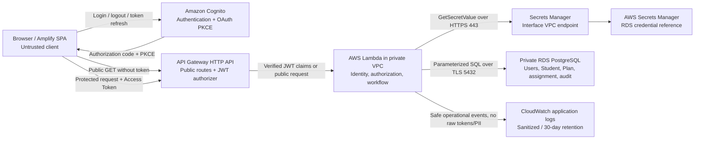

# CO-ED V3 architecture, trust boundaries, and privacy baseline

เอกสารนี้สรุปสถาปัตยกรรมที่ส่งมอบและ Accepted Decisions D01-D08 ของ
V3 หากพบข้อขัดแย้ง ให้แก้ที่
Decision Issue ต้นทางก่อน ไม่สร้าง policy ใหม่จากเอกสารนี้

## Implementation status

- Public Company Directory ของ V2 ยังทำงานแบบ public read-only ตามเดิม
- Cognito, JWT authorizer, production CORS และ private secret access ถูกเตรียมใน
  [#58](https://github.com/zero-h0ur/CS361_G03_Cooperative-Education-Planning-Management-System-/issues/58)
- Forward-only V3 schema และ audit structures ถูกเพิ่มใน
  [#56](https://github.com/zero-h0ur/CS361_G03_Cooperative-Education-Planning-Management-System-/issues/56)
- ระบบยืนยันตัวตน (#61), การตรวจสิทธิ์ส่วนกลาง (#62), Student/Staff workflow
  และ Advisor read-only พัฒนาและรวมไว้ใน main แล้ว
- ตรวจรับใน #84 เมื่อ 2026-10-20 สำหรับข้อมูลจำลองและการสาธิต
  ดู commit, deployment และผลทดสอบใน [สรุปส่งมอบ](../evidence/v3-delivery-index.md)
- Current-session Logout ใช้ RevokeToken ก่อน local cleanup และ Hosted UI logout
  ไม่ใช่ GlobalSignOut/all-device logout; access JWT อาจยังผ่านจนหมดอายุตาม #48
- Application logs ที่ `/aws/lambda/coed-api` ตั้ง retention 30 วันแล้ว แยกจาก RDS audit
- คำสั่งรันและดูแลระบบอยู่ใน [คู่มือพัฒนา](../operations/v3-operating-guide.md)

## Component and data flow



### Request paths

**Public path:** Browser → API Gateway → Lambda → RDS public-field query. อนุญาต
เฉพาะ Company/Position read operations ผ่าน response allowlist ไม่มี Student,
Plan, identity, assignment หรือ private audit data

**Protected path:** Browser ส่ง Cognito Access Token → API Gateway JWT Authorizer
ตรวจ signature, issuer, client และ required scope → Lambda รับ claims จาก trusted
authorizer context → resolve `(iss, sub)` ไป Internal User ใน RDS → ตรวจ account,
role, ownership/assignment/scope และ workflow state → ทำ transaction → ส่งผลลัพธ์
ผ่าน field allowlist

Client-supplied `role`, `userId`, `studentId`, `advisorId` และ `staffId` ไม่ใช่
trusted identity และต้องไม่ถูกใช้ตัดสินสิทธิ์

## Trust boundaries and enforcement points

| Boundary | Trusted input after boundary | Required enforcement |
| --- | --- | --- |
| Browser → Cognito | OAuth result ที่ผ่าน Authorization Code + PKCE | Exact callback/logout allowlist, no client secret, no self-registration |
| Browser → API Gateway | Public request หรือ JWT claims ที่ authorizer ตรวจแล้ว | Protected route ต้อง require Access Token และ `coed-api/access`; CORS ไม่ใช่ authorization |
| API Gateway → Lambda | `requestContext.authorizer.jwt.claims` | Resolve identity จาก `(iss, sub)`; ไม่เชื่อ identity/role จาก request |
| Lambda policy boundary | Active Internal User และ resource context จาก RDS | Deny by default; ตรวจ role, ownership, active assignment, Staff scope, state และ version ทุก protected request |
| Lambda → Secrets Manager | Lambda runtime ผ่าน private endpoint | อนุญาตเฉพาะ `GetSecretValue`/`DescribeSecret` ของ secret ที่กำหนด; ห้าม log secret |
| Lambda → RDS | Parameterized SQL ผ่าน TLS | Foreign key/check/unique/exclusion constraints และ transaction boundary |
| Response/log boundary | Authorized result หลัง allowlist/redaction | ห้าม raw token, credential, identity key และ private fields เกินจำเป็น |

UI route guard และการซ่อนปุ่มช่วยด้าน UX เท่านั้น ไม่ใช่ security boundary

## Authorization baseline

| Role | Allowed V3 capability | Explicit boundary |
| --- | --- | --- |
| `STUDENT` | อ่าน Profile/Plan ของตนเอง; create/edit/submit ตาม state | ห้ามอ่านหรือแก้ resource ของ Student คนอื่น |
| `ADVISOR` | อ่านเฉพาะ assigned Student/Plan ที่ assignment ยัง active | Read-only; ไม่มี create/update/start-review/return/approve |
| `STAFF` | อ่านและ review เฉพาะ Operational Scope ที่กำหนด | ห้ามแก้ Plan content แทน Student และห้ามขยาย scope จาก client parameters |
| `ADMIN` | Controlled account/identity/role provisioning | ไม่มี implicit Student/Plan read หรือ review permission |
| `SYSTEM` | Controlled maintenance/audit actor | ใช้เฉพาะ operation ที่ออกแบบไว้ ไม่ใช่ global bypass |

ทุก action ที่ไม่ได้อนุญาตไว้ถือเป็น `DENY` และ Backend เป็นผู้บังคับใช้เสมอ

## Data ownership and privacy

| Classification | V3 examples | Handling rule |
| --- | --- | --- |
| `PUBLIC` | Company/Position fields ใน public allowlist | อ่านแบบ anonymous ได้ แต่ยังเป็น read-only |
| `INTERNAL` | Internal UUID, workflow state, version | ส่งออกเฉพาะเมื่อ contract ต้องใช้ |
| `PRIVATE` | Student profile, Plan, assignment, audit reason/comment | Login + ownership/assigned/scoped authorization |
| `SENSITIVE` | `(iss, sub)`, token, credential, database secret | จำกัดที่ auth/runtime boundary; ห้าม fixture, response และ log |

- RDS เป็น source of truth สำหรับ Internal User, role, account status, ownership,
  assignment, Staff scope, Plan state และ audit
- External identity link ใช้ `(external_issuer, external_subject)`; ห้ามใช้ email
  เป็น immutable identity key
- Student ที่ link กับ V3 identity ต้องมี official profile ครบและ Internal User
  ต้องมี role `STUDENT`
- `students.department` เป็นคนละ field กับ `program` และ `major`, แก้ผ่าน
  Admin/Ops เท่านั้น และใช้เทียบกับ `staff_scopes.department`
- Company/Position ใน Plan ต้องอ้างอิง record ที่มีอยู่ ห้ามสร้างข้อมูลซ้ำผ่าน Plan
- Development/Test ใช้ synthetic หรือ anonymized data เท่านั้น

## Plan workflow and audit path

สถานะ V3 ได้แก่ `DRAFT`, `SUBMITTED`, `UNDER_REVIEW`, `NEEDS_REVISION`,
`APPROVED` และ `CANCELLED`

- Student แก้ Plan content ได้เฉพาะ `DRAFT` และ `NEEDS_REVISION`
- Staff ทำ review mutation ได้เฉพาะ allowed transition และภายใน Staff scope
- Advisor ไม่มี mutation permission
- ทุก mutation ต้องตรวจ current state และ optimistic concurrency `version`
- Retry ใช้ operation/idempotency record เพื่อไม่สร้าง transition หรือ audit ซ้ำ
- Plan ห้าม hard delete; ใช้ `CANCELLED` เพื่อรักษาประวัติ
- `CANCELLED` เป็น state/service contract; ไม่มี HTTP `/cancel` route หรือ Cancel Plan UI ที่อ้างว่าส่งมอบใน V3

```text
Trusted actor context
        ↓
Role + ownership/assignment/scope check
        ↓
State + version + idempotency check
        ↓
Single database transaction
  ├─ Update Plan/current state
  ├─ Record operation result
  └─ Append immutable audit event
        ↓
Commit all หรือ rollback all
```

Audit event ต้องบันทึก actor, action, previous/new state, timestamp และ
comment/reason ที่เกี่ยวข้อง โดย `audit_events` และ `plan_operations` เป็น
append-only ใน application path

## V3 scope boundary

### In scope

- Cognito login/logout/refresh และ protected route authentication
- Server-side role, ownership, Advisor assignment และ Staff scope authorization
- Student Profile และ own Plan workflow
- Staff review workflow; Advisor assigned-scope read-only
- Forward-only schema, optimistic concurrency, idempotency และ immutable audit
- Public V2 Company Directory compatibility
- Privacy controls, synthetic fixtures, secret references และ deployment evidence

### Out of scope

- Deadline/calendar, near-due/overdue และ full multi-round tracking
- Long-term placement progression, dashboard, analytics และ executive reporting
- Company coordinator portal และ Company/Position administration UI
- In-app Admin UI, file upload, notifications และ external integrations
- Full Infrastructure as Code, performance/cost optimization และ architecture redesign
- Production Student data ที่ยังไม่มี permission, minimization และ retention approval

## Accepted decision index

| Decision | Source |
| --- | --- |
| D01 — V3 scope and release boundary | [#47](https://github.com/zero-h0ur/CS361_G03_Cooperative-Education-Planning-Management-System-/issues/47) |
| D02 — Authentication provider and session trust | [#48](https://github.com/zero-h0ur/CS361_G03_Cooperative-Education-Planning-Management-System-/issues/48) |
| D03 — Role and permission matrix | [#49](https://github.com/zero-h0ur/CS361_G03_Cooperative-Education-Planning-Management-System-/issues/49) |
| D04 — Private-data classification and masking | [#50](https://github.com/zero-h0ur/CS361_G03_Cooperative-Education-Planning-Management-System-/issues/50) |
| D05 — Student profile and identity linking | [#51](https://github.com/zero-h0ur/CS361_G03_Cooperative-Education-Planning-Management-System-/issues/51) |
| D06 — Plan fields, validation and editability | [#52](https://github.com/zero-h0ur/CS361_G03_Cooperative-Education-Planning-Management-System-/issues/52) |
| D07 — Workflow state machine | [#54](https://github.com/zero-h0ur/CS361_G03_Cooperative-Education-Planning-Management-System-/issues/54) |
| D08 — Advisor assignment and Staff scope | [#53](https://github.com/zero-h0ur/CS361_G03_Cooperative-Education-Planning-Management-System-/issues/53) |

Operational AWS evidence และข้อจำกัด VocLabs อยู่ใน
[#58](https://github.com/zero-h0ur/CS361_G03_Cooperative-Education-Planning-Management-System-/issues/58)
และ migration/recovery evidence อยู่ใน
[`docs/database/v3-migration-002-recovery.md`](../database/v3-migration-002-recovery.md)
