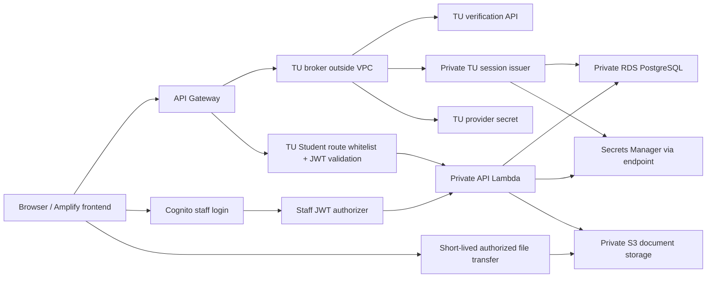

# CO-ED V4 architecture

Updated: 2026-11-08 (Asia/Bangkok). Describes source through `c63b238` plus the unreleased routed-TU-audience extension below; this is not an assertion that every route is enabled on AWS. Read [current deployment](../operations/current-deployment.md) for the released subset and [verification](../operations/student-intake-verification.md) for evidence. [Decisions](../decisions/v4-tu-intake-boundaries.md) explain why these boundaries exist.

## System and trust boundaries

This is a logical trust-boundary diagram, not an exact inventory of every Gateway integration or route. Public directory reads also reach the API with their own privacy restrictions.

- **Frontend:** public pages and authenticated shell hosted on Amplify. Browser never receives database credentials or signing keys. Preview is a separate synthetic memory mode, not live authentication/storage.
- **TU Student:** `/api/v3/auth/tu-login` and `/api/v3/auth/tu-register` reach `coed-tu-auth`. The outside-VPC broker verifies TU using `Application-Key` and `UserName`/`PassWord`, then uses narrow qualified Lambda Invoke to the private issuer. No raw credentials are retained as application records/logs.
- **Private issuer:** resolves the verified TU identity or controlled first registration, accesses private RDS and signs a CO-ED session. Registration challenges are not full application sessions. Issuer/audience/signing configuration must agree across broker, issuer, API and database functions.
- **Cognito staff:** Coordinator/Committee and preprovisioned legacy roles authenticate through Cognito; protected staff Gateway routes retain the JWT authorizer. Backend additionally checks active internal role/scope/assignment.
- **TU bridge:** `/api/tu-proxy` admits only explicit Student method/path pairs, then verifies the TU-issued session server-side. It is not a generic unauthenticated proxy and does not give TU identities staff routes. Listing a route in the bridge does not imply the deployment gate enables it.
- **API/RDS:** database role `coed_app` is least-privilege runtime, not migration owner. Private database connections use TLS. Identity login/registration use separate narrow capabilities; registration functions are execute-only to their runtime role.
- **Storage:** files live in private S3, relational authorization/metadata and retained snapshots in RDS. Presigned transfer is issued only after API authorization. CloudWatch operational logs are separate from business audit in RDS.

## Identity versus academic provenance

Both providers map to internal `users`, `students` and active `external_identity_links`; a login provider is not the recipient of an application.

First onboarding requires TU-confirmed Student identity and normal status. Name, student number, email, faculty, department and TU status remain provider read-only. Track and entry year are self-reported. Curriculum and major group used for intake are also self-reported/pending Coordinator review when no official mapping exists. Do not infer a verified curriculum from a ten-digit ID, an email, or pilot CPE/CS routing metadata.

An existing Cognito Student account is not silently relinked during TU login. Old browser-only application text can be recovered as an owner-reviewed Draft; files must be uploaded again and Submit confirmed. It is not proof of an earlier server delivery.

## Phase 1 is not a legacy plan

| Domain | Purpose | Important distinction |
| --- | --- | --- |
| Legacy V3 plan | Company/position/Project preference, Staff/Advisor/placement workflow | Retained for compatibility; old document references are not automatically S3 attachments |
| Phase 1 application | Grades, four actual documents, seven declarations, round-specific intake | Immutable submitted evidence delivered to assigned Coordinator |
| Selection/meeting | Ranking and meeting decision by Committee | Queueing an application does not forward/select/publish it |

The current Phase 1 journey is Draft → save partial inputs → stage/finalize required files → readiness → explicit Submit → Coordinator queue. A readiness result separates **complete evidence** from **qualification**. With missing verified credits/repeat rules, assessment is `UNKNOWN`/manual review rather than `PASS`; missing required inputs/files and known blocking results still fail.

## Submission transaction and recipient

The destination is an active operator-configured cohort/Coordinator, not a Student-selected email or an auth-provider mailbox. Submit commits together:

1. Immutable `phase1_submissions` snapshot, checksum and contract version.
2. Matching `phase1_submission_deliveries` destination receipt.
3. Application state/version, operation receipt and business audit/events.

If any step fails, the transaction rolls back. Operation IDs handle retries; expected versions reject stale changes. The UI shows “ส่งเข้าคิวผู้ประสานงานแล้ว” only with matching retained evidence. Coordinator reads the same snapshot and authorized document IDs, not a re-created browser form. A submitted receipt means **waiting for review**, not acceptance, forwarding or selection.

## Intake gates and closing behavior

An operation must pass all layers: Gateway/verified identity → maintenance stage → exact pilot audience/round → internal role/ownership/scope → current intake control/correction exception → input/evidence/state/version checks.

Source extension, 2026-11-08 (not deployed): `COED_INTAKE_AUDIENCE` defaults to `pilot`. The explicit value `routed-tu-students` replaces the single Student UUID check with server-side TU registration/link and route membership checks; unknown values fail closed within intake stages. It retains the configured `COED_INTAKE_PILOT` round and Coordinator binding and all three rollout stages. A Student needs their own active exact TU issuer/subject link and completed TU onboarding. Faculty/department come from retained TU identity; program type and curriculum remain self-reported, pending review. An active latest `phase1_intake_routes` entry must match these fields and lead to the configured active Coordinator/cohort. A blank curriculum allows starting a Draft for a matching route; saving a curriculum and subsequent mutations require a matching curriculum route. A public round alone cannot grant membership. Existing ownership, readiness, Close, immutable receipt and audit rules still apply. This adds no review/forward/Committee access. See [decision D8](../decisions/v4-tu-intake-boundaries.md#d8-explicit-routed-tu-audience-within-the-existing-intake-boundary).

| Control | Meaning |
| --- | --- |
| `SCHEDULED` | Timezone-aware open/close instants; start inclusive and close exclusive |
| `MANUAL_OPEN` | Actual server opening timestamp, `closes_at = NULL`; remains open until changed |
| `CLOSED` | No ordinary Draft create/save/upload/finalize/Submit; authorized reads remain |

Only the active Cognito Coordinator assigned to the whole provisioned round can change intake mode. Each change has optimistic version, idempotent receipt and immutable mode event. The cycle advisory lock serializes mode changes with Student mutations. A transaction admitted before Close may complete first; later mutations after Close commits fail. File finalization rechecks the gate after external storage work.

Returned corrections use a genuine retained return/cohort/review deadline. Manual opening cannot extend that deadline; closing ordinary intake does not erase the exception. These rules exist in source; review/return/forward remain disabled in the current pilot. Already-issued S3 upload/download URLs are bearer capabilities with normal expiry (300s/60s), not instantly revoked by closing intake.

## Documents

Required pilot kinds are Resume/CV, Transcript, Student photo and Conduct certificate. Upload tickets, actual bytes/size/checksum verification, immutable document metadata and final attachment are separate steps. Local tests use actual local bytes; that alone does not prove S3/browser CORS.

Coordinator has separate **Open** and **Download** actions. Named Download preserves authorized original filename/extension; preview restores safe PDF/JPEG/PNG MIME. Unknown types stay download-only. Browser PDF toolbar naming is not the supported Download guarantee. Signed links, file contents and personal filenames must not be published in evidence.

## Database lineages

These are **not** one automatically applied `001–022` chain:

| Path | Baseline/purpose | Rule |
| --- | --- | --- |
| `src/db/migrations/` | Reviewed fresh/workspace lineage: 001–014 and 017 (15 files) | Immutable LF bytes/allowlist in `reviewed-migrations.mjs` |
| `src/db/upgrades/` | Observed RDS lineage: 018 delivery, 019 onboarding, 020 issuer alignment, 021 pending intake, 022 controls | Separate catalog/history/hash/approval gates; never general fresh migrator on RDS |
| `src/db/proposals/phase1_intake_controls.sql` | Review copy of 022 | Not a third migration or separate Apply |

Original live `014_phase1_review_handoff.sql` and `015_phase1_schedule_audit_integrity.sql` were unavailable. Same-numbered workspace files are not replacements. Preserve their observed history/checksums; do not claim the originals were recovered. Later upgrades use the observed catalog as baseline, trial rollback, preservation checks and append-only history. This cannot prove every action an unavailable historical SQL ever performed.

Principal records: `users`, `students`, `external_identity_links`, `tu_student_registrations`; `phase1_applications`, `phase1_uploads`, `phase1_documents`, `phase1_submissions`, `phase1_submission_deliveries`; `selection_cohorts`, `phase1_intake_routes`, `phase1_intake_controls`, `phase1_intake_control_events`.

## Source map

| Area | Entry points |
| --- | --- |
| TU split login/onboarding | [broker](../../src/tu-auth-broker.js), [broker service](../../src/auth/tu-broker-service.js), [issuer](../../src/tu-session-issuer.js), [registration service](../../src/auth/tu-registration-service.js) |
| Transport and rollout gates | [TU bridge](../../src/auth/tu-bridge.js), [maintenance](../../src/maintenance.js), [pilot access](../../src/shared/application-access.js) |
| Application/receipt/routing | [application service](../../src/api/services/application-service.js), [delivery](../../src/db/phase1-delivery.js), [pending intake](../../src/db/phase1-intake.js), [receipt UI](../../src/frontend/student/application-receipt.js) |
| Coordinator/controls | [Coordinator service](../../src/api/services/coordinator-workspace-service.js), [control service](../../src/api/services/intake-control-service.js), [time evaluator](../../src/shared/intake-control.js) |
| SQL/release | [reviewed migrations](../../scripts/operations/reviewed-migrations.mjs), [021](../../src/db/upgrades/021_phase1_pending_intake.sql), [022](../../src/db/upgrades/022_coordinator_intake_controls.sql) |
| Verification entry | [package scripts](../../package.json), [CI workflow](../../.github/workflows/v4-verification.yml), [current verification](../operations/student-intake-verification.md) |

Historical [V3 architecture](G03-V3-architecture.md) and diagrams remain available; they do not include this complete TU/onboarding/intake path.
