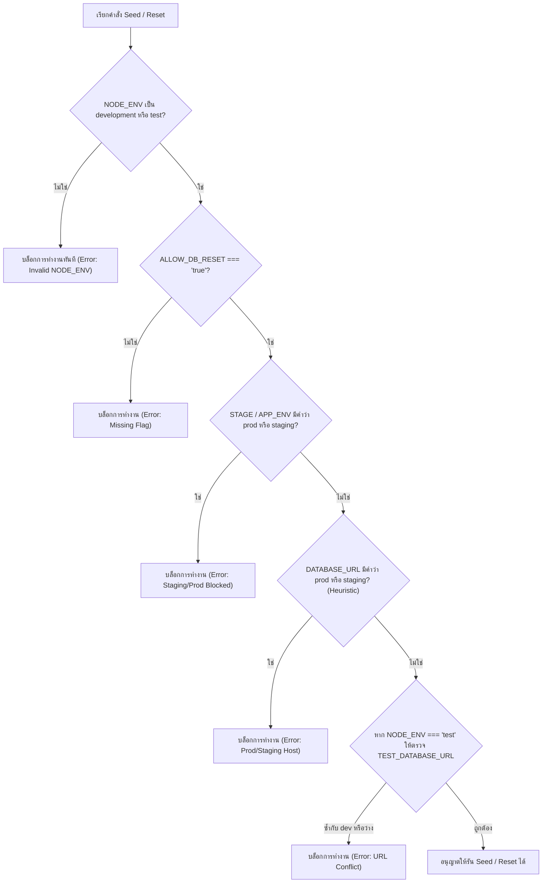

# CO-ED V3 Synthetic Fixtures & Destructive-Seed Guards

เอกสารนี้อธิบายชุดข้อมูลสังเคราะห์ (Synthetic Fixtures) และระบบป้องกันคำสั่งทำลายข้อมูล (Destructive-Seed Guards) สำหรับระบบ CO-ED Version 3 ตามข้อกำหนดใน Issue [#60](https://github.com/zero-h0ur/CS361_G03_Cooperative-Education-Planning-Management-System-/issues/60) ภายใต้สถาปัตยกรรมและ Schema จาก Issue [#56](https://github.com/zero-h0ur/CS361_G03_Cooperative-Education-Planning-Management-System-/issues/56)

---

## 1. จุดประสงค์ (Goal)

1. จัดเตรียมชุดข้อมูลตัวอย่างที่จำเป็นสำหรับพัฒนาระบบและทดสอบ UI / API ใน CO-ED V3 ให้มีโครงสร้างครบถ้วน
2. รักษาความปลอดภัยของข้อมูลขั้นสูงสุด: **ปราศจาก PII (ข้อมูลส่วนบุคคลจริง), รหัสผ่าน/Credential และข้อมูลคัดลอกจาก Production อย่างเด็ดขาด** โดยปฏิบัติตามมาตรฐาน RFC 2606 อย่างเคร่งครัด
3. ป้องกันการลบหรือ Reset ข้อมูลโดยไม่ตั้งใจ (Accidental Data Wipe) บน Staging และ Production ด้วยการบล็อกผ่าน **Multi-layered Environment Guards** โดยค่าเริ่มต้น
4. ทำให้กระบวนการ Seed เป็นแบบ **Deterministic และ Rerunnable (Idempotent)** สามารถรันซ้ำได้โดยไม่เกิดข้อผิดพลาดด้าน Database Constraints หรือคีย์ซ้ำ

---

## 2. โครงสร้างไฟล์ (Files & Assets)

| ไฟล์ / เส้นทาง | หน้าที่และคำอธิบาย |
|---|---|
| `data/v3/fixtures.json` | ไฟล์ข้อมูลจำลอง Canonical V3 Synthetic Fixtures ในรูปแบบ JSON |
| `src/db/seed.js` | สคริปต์รัน Seed & Reset พร้อม Destructive-Seed Guards และการจัดการ Triggers |
| `scripts/validate-v3-fixtures.mjs` | ตัวตรวจสอบความถูกต้องของ Fixtures (RFC 2606 Email, Exact Department Code, C.E. Year, UUID v4, Foreign Keys, Overlap) |
| `tests/v3-dataset.test.mjs` | ชุดการทดสอบโครงสร้างข้อมูลและความปลอดภัยของ Fixtures ด้วย `node:test` |
| `tests/v3-fixtures.test.js` | ชุดการทดสอบ Integration ของ Environment Guards และ Database Seeding ด้วย `jest` |

---

## 3. ขอบเขตข้อมูลจำลอง (Synthetic Fixture Inventory)

ข้อมูลใน `data/v3/fixtures.json` สอดคล้องกับตารางและข้อจำกัดตาม Migration `001_initial_schema.sql` และ `002_v3_identity_student_plan_assignment_audit.sql` โดยไม่มีการเพิ่ม Field หรือ Schema นอกเหนือจากที่ระบุใน Issue [#56](https://github.com/zero-h0ur/CS361_G03_Cooperative-Education-Planning-Management-System-/issues/56) ดังนี้:

### 3.1 บัญชีผู้ใช้และตัวตน (`users` และ `external_identity_links`)
* **STUDENT (5 บัญชี)**: บัญชีนักศึกษาสำหรับทดสอบ Flow ต่างๆ (Active 4 บัญชี, Disabled 1 บัญชีสำหรับทดสอบ Authorization Failure `ACCOUNT_DISABLED`)
* **ADVISOR (2 บัญชี)**: อาจารย์ที่ปรึกษาสหกิจศึกษา สำหรับทดสอบการมองเห็นแบบ Scoped Advisor Visibility
* **STAFF (2 บัญชี)**: เจ้าหน้าที่ประจำคณะ/ภาควิชา สำหรับทดสอบ Staff Scoped Authorization ข้ามภาควิชา
* **ADMIN (1 บัญชี)**: ผู้ดูแลระบบที่มีสิทธิ์จัดการ Advisor Assignment และ Staff Scope
* **External Identity Links (10 รายการ)**: จำลอง Issuer ของ AWS Cognito (`mockPool`) พร้อม Subject strings แบบคงที่ และมีตัวอย่างสถานะ `REVOKED`

### 3.2 ข้อมูลประวัตินักศึกษา (`students`)
* ข้อมูลจำลอง 5 รายการที่เชื่อมโยงกับ `users` (`user_id NOT NULL`)
* **Department Code แบบมาตรฐาน**: กำหนดค่า `department` เป็นรหัสตัวย่อตัวพิมพ์ใหญ่ตรงกันทั้งระบบ (เช่น `'CPE'`, `'EE'`) ตามตัวอย่างใน Issue [#53](https://github.com/zero-h0ur/CS361_G03_Cooperative-Education-Planning-Management-System-/issues/53) เพื่อให้ตรงกับ `staff_scopes.department` แบบตัวอักษรต่อตัวอักษร (`s.department = ss.department`)
* **ปีการศึกษา (Academic Year)**: ใช้ระบบปีปฏิทินสากล คริสต์ศักราช (Common Era - C.E.) เป็น **`2026`** ทั้งระบบ เพื่อให้การเปรียบเทียบใน Authorization Predicate ของ Staff และ Advisor ทำงานบนมาตรวัดเดียวกัน
* **อีเมลและรหัสนักศึกษาตาม RFC 2606**: ใช้รหัสสมมติ `65061000x` และอีเมลโดเมนสงวน `@student.example.com` (ภายใต้โดเมนสงวน `example.com` ตาม RFC 2606) โดยไม่มีการอ้างอิงชื่อสถาบันจริงหรือ TLD สาธารณะ

### 3.3 รอบการเปิดรับและดำเนินงาน (`rounds` / Cycles)
* คอลัมน์ทั้งหมด (`academic_year`, `semester`, `status`, `end_date`) มีอยู่ใน Migration `001` และ `002` อยู่แล้ว
* **รอบเปิดดำเนินงาน (`status = 'OPEN'`)**: ปีการศึกษา `2026` ภาคเรียนที่ 1 รองรับการทดสอบ Review Actions, Active Queues และ Submissions
* **รอบปิด (`status = 'CLOSED'`)**: ปีการศึกษา `2026` ภาคเรียนที่ 1 สำหรับทดสอบการปฏิเสธ Action ในรอบที่ปิดแล้ว

### 3.4 แผนการฝึกสหกิจศึกษา (`plans`)
ครอบคลุมทุกสถานะหลักของ V3 Plan Workflow:
1. `APPROVED`: แผนได้รับการอนุมัติแล้ว (Version 4)
2. `UNDER_REVIEW`: แผนอยู่ระหว่างรอ Staff ตรวจสอบ (Version 2)
3. `SUBMITTED`: แผนยื่นเข้าสู่ระบบเรียบร้อย (Version 2)
4. `NEEDS_REVISION`: แผนที่ถูกส่งกลับให้แก้ไขพร้อมบันทึกหมายเหตุ (Version 3)
5. `DRAFT`: แผนฉบับร่างของนักศึกษา (Version 1)
6. `CANCELLED`: แผนที่ถูกยกเลิก (Version 2) เพื่อทดสอบ Partial Unique Index `(student_id, cycle_id) WHERE status <> 'CANCELLED'`

### 3.5 การมอบหมายอาจารย์ที่ปรึกษา (`advisor_assignments`)
* ใช้ปีการศึกษา C.E. (`2026` สำหรับ Active/Revoked และ `2025` สำหรับ Expired)
* ครอบคลุมสถานะ `ACTIVE`, `REVOKED` (พร้อม `revoked_at`, `revoked_by`, `revocation_reason`) และ `EXPIRED`
* ผ่านการตรวจสอบ Exclusion Constraint `btree_gist` ไม่มีการทับซ้อนของช่วงเวลาสำหรับนักศึกษาคนเดียวกันในสถานะ `ACTIVE`

### 3.6 ขอบเขตสิทธิ์ของเจ้าหน้าที่ (`staff_scopes`)
* ใช้รหัส `department` ตรงกับ `students.department` (เช่น `'CPE'`, `'EE'`, `'ME'`)
* กำหนด Scope ทั้งระดับภาควิชาภาพรวม (`program = null`, `academic_year = null`), ระดับหลักสูตร (`program = 'CPE'`), และระดับปีการศึกษา (`academic_year = 2025`)
* ครอบคลุมทั้งสถานะ `ACTIVE` และ `INACTIVE` สำหรับทดสอบ Filter Predicate

### 3.7 ประวัติการทำงานและ Audit Log (`plan_operations` และ `audit_events`)
* บันทึกประวัติครบทุก Action หลัก: `SUBMIT_PLAN`, `REVIEW_PLAN`, `APPROVE_PLAN`, `REQUEST_REVISION`, และ `ASSIGN_ADVISOR`
* ข้อมูลเป็นแบบ Append-only ไม่ละเมิด Trigger ป้องกันการแก้ไขหรือลบ

---

## 4. มาตรการความปลอดภัยของข้อมูล (Data Safety & Privacy)

1. **RFC 2606 Reserved Domains**:
   - สงวนเฉพาะ `example.com`, `example.net`, `example.org` และ TLD `.example` ตามมาตรฐาน RFC 2606
   - อีเมลสังเคราะห์ทั้งหมดลงท้ายด้วย `@student.example.com` ห้ามใช้โดเมนมหาวิทยาลัยจริงหรือบริการอีเมลสาธารณะ
2. **ไม่มี PII จริง**:
   - ชื่อ-นามสกุลทั้งหมดเป็นชื่อสมมติ (เช่น "สมมุติ เรียนดี", "วิภา จำลอง")
3. **ไม่มี Credential / Secret**:
   - ปราศจากรหัสผ่าน, AWS Access Key (`AKIA...`), หรือ Private Token ในทุกตาราง
4. **Deterministic UUIDs**:
   - ใช้ UUID v4 แบบคงที่โดยแยกช่วง Prefix ชัดเจน (เช่น Users: `7000...`, Students: `4000...010x`, Plans: `5000...010x`) เพื่อป้องกัน ID ชนกับข้อมูล V2 เดิม

---

## 5. ระบบป้องกันการลบข้อมูล (Destructive-Seed Guards)

ฟังก์ชัน `assertDestructiveResetAllowed()` ใน `src/db/seed.js` บังคับใช้เงื่อนไขความปลอดภัยแบบหลายชั้น:



### การจัดลำดับความน่าเชื่อถือของการป้องกัน (Defense Hierarchy):

> [!IMPORTANT]
> **ชั้นที่เชื่อถือได้จริงในการบังคับใช้ความปลอดภัย (Authoritative Enforcement Layer)**:
> 1. **`NODE_ENV`**: ต้องเป็น `'development'` หรือ `'test'` เท่านั้น หากเป็นค่าว่าง, `'production'`, หรือ `'staging'` ระบบจะบล็อกทันที
> 2. **`ALLOW_DB_RESET`**: ต้องระบุเป็นตัวอักษร `'true'` อย่างเจาะจง ซึ่งบน Staging และ Production จะไม่มีการตั้งค่า Environment Variable นี้เด็ดขาด
> 3. **`TEST_DATABASE_URL`**: ใน Test Mode ต้องมีค่าและต้องไม่ตรงกับ `DATABASE_URL` เพื่อป้องกันการลบ Development DB

> [!NOTE]
> **Heuristic Defense Layer (ชั้นเสริม)**:
> การตรวจคำว่า `prod` หรือ `staging` ใน Database Connection URL และตัวแปร `STAGE` / `APP_ENV` เป็นเพียงมาตรการเสริม (Defense-in-depth heuristic) เพื่อช่วยเตือนหากมีการตั้งชื่อไว้อย่างชัดเจน แต่ **ไม่สามารถใช้เป็นหลักประกันหลักได้** เนื่องจาก RDS Hostname บน AWS มักเป็นรหัสสุ่ม (เช่น `xxx.ap-southeast-1.rds.amazonaws.com`) ที่ไม่มีคำว่า prod/staging ดังนั้นจึงต้องพึ่งพา `NODE_ENV` และ `ALLOW_DB_RESET` เป็นหลักเสมอ

---

## 6. ลำดับการ Reset และ Trigger Handling

เนื่องจาก V3 Database มี Trigger ป้องกันการลบข้อมูลแบบ Append-only (`trg_plans_no_delete`, `trg_advisor_assignments_no_delete`, `trg_plan_operations_immutable`, `trg_audit_events_immutable`) การ Reset ข้อมูลใน Environment ที่ปลอดภัยจะทำภายใน Transaction ดังนี้:

1. **Disable Triggers ชั่วคราว**: ปิด Trigger ป้องกันการลบภายใน Transaction ของ Client ที่ได้รับสิทธิ์
2. **Delete ตามลำดับ Foreign Key (ย้อนกลับ)**:
   - `audit_events` -> `plan_operations` -> `advisor_assignments` -> `staff_scopes` -> `plans` -> `students` -> `external_identity_links` -> `users` -> `document_metadata` -> `rounds` -> `positions` -> `companies`
3. **Insert V2 Base Data**: ข้อมูลบริษัท, ตำแหน่งงาน และเอกสารพื้นฐาน
4. **Insert V3 Fixture Data**: ข้อมูล Users, Identity Links, Student Profiles, Cycles, Plans, Assignments, Scopes, Operations และ Audit
5. **Re-enable Triggers ทันที**: เปิดใช้งาน Triggers ทั้งหมดกลับคืนสู่สถานะเดิม
6. **Commit Transaction**: ข้อมูลบันทึกเสร็จสมบูรณ์ หากเกิด Error ขั้นตอนใดจะ Rollback ทั้งหมด

---

## 7. วิธีใช้งานคำสั่ง (Usage Instructions)

ความสอดคล้องระหว่างการรันผ่าน **CLI** และการเรียกใช้ผ่าน **Programmatic API**:

### 7.1 การรันผ่าน Command Line Interface (CLI)
* **Seed ข้อมูลสำหรับ Development (รวม V2 Base + V3 Fixtures อัตโนมัติ)**:
  ```bash
  NODE_ENV=development ALLOW_DB_RESET=true npm run seed
  ```
  หรือสั่งแบบเจาะจง:
  ```bash
  NODE_ENV=development ALLOW_DB_RESET=true npm run seed:v3
  ```
  *(หมายเหตุ: Script `seed` และ `seed:v3` ใน `package.json` จะโหลด V3 Fixtures เป็นค่าเริ่มต้น เพื่อให้ Developer ได้รับข้อมูล V3 ครบถ้วนทันที)*

* **Seed เฉพาะข้อมูล V2 (Legacy-only 53 records)**:
  ```bash
  NODE_ENV=development ALLOW_DB_RESET=true npm run seed:v2
  ```
  *(หมายเหตุ: ส่ง flag `--v2-only` เพื่อจำกัดการ Seed ไว้เฉพาะ 53 แถวเดิม)*

### 7.2 การเรียกใช้ผ่าน Programmatic Code (ใน Unit/Integration Tests)
* **`seed()` หรือ `seed({ includeV3: false })`**:
  โหลดเฉพาะ V2 canonical dataset (53 แถว) เพื่อคงความถูกต้องและการ Backward-compatibility ให้กับ Unit Tests เดิมของ V2 (เช่น `tests/dal.test.js`) โดยไม่ทำให้ Assertion ล้มเหลว
* **`seed({ includeV3: true })` หรือ `seedV3()`**:
  โหลดข้อมูลครบทั้ง V2 Base Dataset และ V3 Synthetic Fixtures สำหรับใช้ใน Integration Tests ของ V3 (เช่น `tests/v3-fixtures.test.js`)

### 7.3 การตรวจสอบความถูกต้องของ Fixtures
```bash
# ตรวจสอบความถูกต้องของ JSON Fixtures ตาม RFC 2606, Department และ C.E. Year
node scripts/validate-v3-fixtures.mjs

# รัน Automated Test Suite สำหรับ Fixtures และ Seed Guards
npm run test:fixtures
```

---

## 8. ข้อควรระวัง (Precautions & Caveats)

> [!CAUTION]
> **ห้ามรันคำสั่ง Seed / Reset ใน Production หรือ Staging Database เป็นอันขาด**
> แม้ระบบจะมี Guard ป้องกันไว้ แต่เพื่อความปลอดภัยสูงสุด ไม่ควรตั้งค่า `ALLOW_DB_RESET=true` บนเครื่องเซิร์ฟเวอร์จริง

> [!WARNING]
> **ห้ามคัดลอกข้อมูลส่วนบุคคลจริง (PII) มาใส่ในไฟล์ `data/v3/fixtures.json`**
> หากต้องการเพิ่มข้อมูลสำหรับทดสอบ Use Case ใหม่ ให้ใช้ชื่อสมมติและอีเมลโดเมนสงวน `@student.example.com` เท่านั้น

> [!NOTE]
> **การคงความสอดคล้องกับ Migration 002 (Issue #56)**:
> Fixture ชุดนี้ใช้เฉพาะคอลัมน์และตารางที่มีอยู่จริงใน `001_initial_schema.sql` และ `002_v3_identity_student_plan_assignment_audit.sql` โดยไม่มีการเพิ่ม Field ใหม่ตามข้อตกลง Coordination Note
