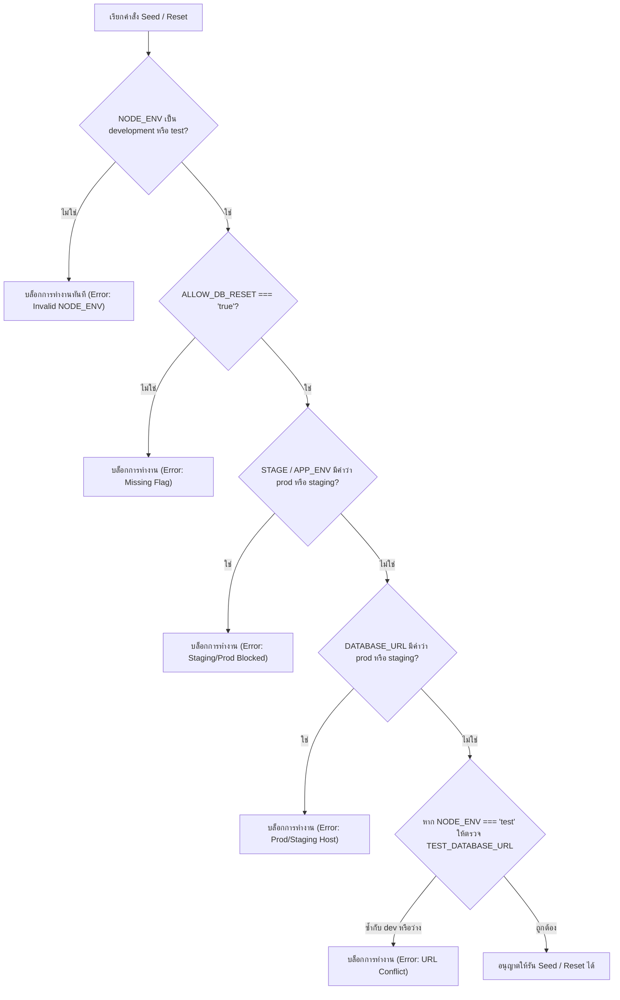

# CO-ED V3 Synthetic Fixtures & Destructive-Seed Guards

เอกสารนี้อธิบายชุดข้อมูลสังเคราะห์ (Synthetic Fixtures) และระบบป้องกันคำสั่งทำลายข้อมูล (Destructive-Seed Guards) สำหรับระบบ CO-ED Version 3 ตามข้อกำหนดใน Issue [#60](https://github.com/zero-h0ur/CS361_G03_Cooperative-Education-Planning-Management-System-/issues/60) ภายใต้สถาปัตยกรรมและ Schema จาก Issue [#56](https://github.com/zero-h0ur/CS361_G03_Cooperative-Education-Planning-Management-System-/issues/56)

---

## 1. จุดประสงค์ (Goal)

1. จัดเตรียมชุดข้อมูลตัวอย่างที่จำเป็นสำหรับพัฒนาระบบและทดสอบ UI / API ใน CO-ED V3 ให้มีโครงสร้างครบถ้วน
2. รักษาความปลอดภัยของข้อมูลขั้นสูงสุด: **ปราศจาก PII (ข้อมูลส่วนบุคคลจริง), รหัสผ่าน/Credential และข้อมูลคัดลอกจาก Production อย่างเด็ดขาด**
3. ป้องกันการลบหรือ Reset ข้อมูลโดยไม่ตั้งใจ (Accidental Data Wipe) บน Staging และ Production ด้วยการบล็อกผ่าน **Multi-layered Environment Guards** โดยค่าเริ่มต้น
4. ทำให้กระบวนการ Seed เป็นแบบ **Deterministic และ Rerunnable (Idempotent)** สามารถรันซ้ำได้โดยไม่เกิดข้อผิดพลาดด้าน Database Constraints หรือคีย์ซ้ำ

---

## 2. โครงสร้างไฟล์ (Files & Assets)

| ไฟล์ / เส้นทาง | หน้าที่และคำอธิบาย |
|---|---|
| `data/v3/fixtures.json` | ไฟล์ข้อมูลจำลอง Canonical V3 Synthetic Fixtures ในรูปแบบ JSON |
| `src/db/seed.js` | สคริปต์รัน Seed & Reset พร้อม Destructive-Seed Guards และการจัดการ Triggers |
| `scripts/validate-v3-fixtures.mjs` | ตัวตรวจสอบความถูกต้องของ Fixtures (Schema, UUID v4, PII Checks, Foreign Keys, Overlap) |
| `tests/v3-dataset.test.mjs` | ชุดการทดสอบโครงสร้างข้อมูลและความปลอดภัยของ Fixtures ด้วย `node:test` |
| `tests/v3-fixtures.test.js` | ชุดการทดสอบ Integration ของ Environment Guards และ Database Seeding ด้วย `jest` |

---

## 3. ขอบเขตข้อมูลจำลอง (Synthetic Fixture Inventory)

ข้อมูลใน `data/v3/fixtures.json` สอดคล้องกับตารางและข้อจำกัดตาม Migration `002_v3_identity_student_plan_assignment_audit.sql` อย่างเคร่งครัด โดยแบ่งกลุ่มข้อมูลดังนี้:

### 3.1 บัญชีผู้ใช้และตัวตน (`users` และ `external_identity_links`)
* **STUDENT (5 บัญชี)**: บัญชีนักศึกษาสำหรับทดสอบ Flow ต่างๆ (Active 4 บัญชี, Disabled 1 บัญชีสำหรับทดสอบ Authorization Reject `ACCOUNT_DISABLED`)
* **ADVISOR (2 บัญชี)**: อาจารย์ที่ปรึกษาสหกิจศึกษา สำหรับทดสอบการมองเห็นแบบ Scoped Advisor Visibility
* **STAFF (2 บัญชี)**: เจ้าหน้าที่ประจำคณะ/ภาควิชา สำหรับทดสอบ Staff Scoped Authorization
* **ADMIN (1 บัญชี)**: ผู้ดูแลระบบที่มีสิทธิ์จัดการ Advisor Assignment และ Staff Scope
* **External Identity Links (10 รายการ)**: จำลอง Issuer ของ AWS Cognito (`mockPool`) พร้อม Subject strings แบบคงที่ และมีตัวอย่างสถานะ `REVOKED`

### 3.2 ข้อมูลประวัตินักศึกษา (`students`)
* ข้อมูลจำลอง 5 รายการที่เชื่อมโยงกับ `users` (`user_id NOT NULL`)
* ครบถ้วนตาม Accepted Contract ของ Issue [#51](https://github.com/zero-h0ur/CS361_G03_Cooperative-Education-Planning-Management-System-/issues/51) และ [#53](https://github.com/zero-h0ur/CS361_G03_Cooperative-Education-Planning-Management-System-/issues/53) โดยเฉพาะฟิลด์ **`department`** (เช่น `Computer Engineering`, `Electrical Engineering`)
* รหัสนักศึกษาและอีเมลสังเคราะห์: ใช้รูปแบบ `65061000x` และโดเมนสงวน `@cmu.example.ac.th` ตาม RFC 2606

### 3.3 รอบการเปิดรับและดำเนินงาน (`rounds` / Cycles)
* **รอบเปิดดำเนินงาน (`status = 'OPEN'`)**: ปีการศึกษา 2568 ภาคเรียนที่ 1 รองรับการทดสอบ Review Actions, Active Queues และ Submissions
* **รอบปิด (`status = 'CLOSED'`)**: สำหรับทดสอบการปฏิเสธ Action ในรอบที่ปิดแล้ว

### 3.4 แผนการฝึกสหกิจศึกษา (`plans`)
ครอบคลุมทุกสถานะหลักของ V3 Plan Workflow:
1. `APPROVED`: แผนได้รับการอนุมัติแล้ว (Version 4)
2. `UNDER_REVIEW`: แผนอยู่ระหว่างรอ Staff ตรวจสอบ (Version 2)
3. `SUBMITTED`: แผนยื่นเข้าสู่ระบบเรียบร้อย (Version 2)
4. `NEEDS_REVISION`: แผนที่ถูกส่งกลับให้แก้ไขพร้อมบันทึกหมายเหตุ (Version 3)
5. `DRAFT`: แผนฉบับร่างของนักศึกษา (Version 1)
6. `CANCELLED`: แผนที่ถูกยกเลิก (Version 2) เพื่อทดสอบ Partial Unique Index `(student_id, cycle_id) WHERE status <> 'CANCELLED'`

### 3.5 การมอบหมายอาจารย์ที่ปรึกษา (`advisor_assignments`)
* มีทั้งสถานะ `ACTIVE`, `REVOKED` (พร้อม `revoked_at`, `revoked_by`, `revocation_reason`) และ `EXPIRED`
* ผ่านการตรวจสอบ Exclusion Constraint `btree_gist` ไม่มีการทับซ้อนของช่วงเวลาสำหรับนักศึกษาคนเดียวกันในสถานะ `ACTIVE`

### 3.6 ขอบเขตสิทธิ์ของเจ้าหน้าที่ (`staff_scopes`)
* กำหนด Scope ทั้งระดับภาควิชาภาพรวม (`department`), ระดับหลักสูตร (`program`), และระดับปีการศึกษา (`academic_year`)
* มีทั้งสถานะ `ACTIVE` และ `INACTIVE` สำหรับทดสอบ Filter Predicate

### 3.7 ประวัติการทำงานและ Audit Log (`plan_operations` และ `audit_events`)
* บันทึกการส่งแผน (`SUBMIT_PLAN`), การตรวจสอบ (`REVIEW_PLAN`), การอนุมัติ (`APPROVE_PLAN`), การขอแก้ไข (`REQUEST_REVISION`), และการมอบหมายที่ปรึกษา (`ASSIGN_ADVISOR`)
* รองรับเงื่อนไข Immutability และ Foreign Keys ไปยัง actor/resource

---

## 4. มาตรการความปลอดภัยของข้อมูล (Data Safety & Privacy)

1. **ไม่มี PII จริง**: ชื่อ-นามสกุลทั้งหมดเป็นชื่อสมมติ (เช่น "สมมุติ เรียนดี", "วิภา จำลอง")
2. **ใช้โดเมนสงวน**: อีเมลทั้งหมดลงท้ายด้วย `.example.ac.th` หรือมีคำว่า `example` ห้ามใช้อีเมลจริงหรือบริการสาธารณะ
3. **ไม่มี Credential / Secret**: ไม่มีรหัสผ่าน, AWS Access Key (`AKIA...`) หรือ Private Token ใดๆ ใน Fixture
4. **Deterministic UUIDs**: ใช้ UUID v4 แบบคงที่ในรูปแบบ Prefix ชัดเจน (เช่น Users ขึ้นต้นด้วย `7000...`, Students ขึ้นต้นด้วย `4000...`, Plans ขึ้นต้นด้วย `5000...`) ทำให้ผลลัพธ์เหมือนเดิมทุกครั้งที่รัน

---

## 5. ระบบป้องกันการลบข้อมูล (Destructive-Seed Guards)

ฟังก์ชัน `assertDestructiveResetAllowed()` ใน `src/db/seed.js` บังคับใช้เงื่อนไขความปลอดภัยอย่างเข้มงวด:



### รายละเอียดการตรวจเช็ค:
* **`NODE_ENV`**: ต้องเป็น `'development'` หรือ `'test'` เท่านั้น (หากว่างหรือเป็น `'production'`, `'staging'` จะล้มเหลวทันที)
* **`ALLOW_DB_RESET`**: ต้องระบุเป็นตัวอักษร `'true'` อย่างชัดเจน
* **`STAGE` / `APP_ENV`**: หากมีค่าเป็น `production`, `prod`, `staging`, `stage`, `uat` จะถูกบล็อกโดยเด็ดขาด
* **Database Connection String Guard**: ตรวจสอบ Hostname และชื่อฐานข้อมูล หากพบคำที่สื่อถึง Production หรือ Staging จะระงับการทำงานทันที
* **Test Isolation Guard**: ใน Test Mode ต้องมี `TEST_DATABASE_URL` และต้องไม่ตรงกับ `DATABASE_URL` ของ Development เพื่อป้องกันการลบข้อมูล dev โดยไม่เจตนา

---

## 6. ลำดับการ Reset และ Trigger Handling

เนื่องจาก V3 Database มี Trigger ป้องกันการลบข้อมูลแบบ Append-only (`trg_plans_no_delete`, `trg_advisor_assignments_no_delete`, `trg_plan_operations_immutable`, `trg_audit_events_immutable`) การ Reset ข้อมูลใน Environment ที่ปลอดภัยจะทำภายใน Transaction ดังนี้:

1. **Disable Triggers ชั่วคราว**: ปิด Trigger ป้องกันการลบภายใน Transaction ของ Client ที่ได้รับสิทธิ์
2. **Delete ตามลำดับ Foreign Key (ย้อนกลับ)**:
   - `audit_events`
   - `plan_operations`
   - `advisor_assignments`
   - `staff_scopes`
   - `plans`
   - `students`
   - `external_identity_links`
   - `users`
   - `document_metadata`
   - `rounds`
   - `positions`
   - `companies`
3. **Insert V2 Base Data**: ข้อมูลบริษัท, ตำแหน่งงาน และเอกสารพื้นฐาน
4. **Insert V3 Fixture Data**: ข้อมูล Users, Identity Links, Student Profiles, Cycles, Plans, Assignments, Scopes, Operations และ Audit
5. **Re-enable Triggers ทันที**: เปิดใช้งาน Triggers ทั้งหมดกลับคืนสู่สถานะเดิม
6. **Commit Transaction**: ข้อมูลบันทึกเสร็จสมบูรณ์ หากเกิด Error ขั้นตอนใดจะ Rollback ทั้งหมด

---

## 7. วิธีใช้งานคำสั่ง (Usage Instructions)

### 7.1 Seed ข้อมูลสำหรับ Development (รวม V3 Fixtures อัตโนมัติ)
```bash
NODE_ENV=development ALLOW_DB_RESET=true npm run seed
```
หรือใช้คำสั่งชัดเจน:
```bash
NODE_ENV=development ALLOW_DB_RESET=true npm run seed:v3
```

### 7.2 Seed เฉพาะข้อมูล V2 (Legacy-only 53 records)
```bash
NODE_ENV=development ALLOW_DB_RESET=true npm run seed:v2
```

### 7.3 ตรวจสอบความถูกต้องของ Dataset และ Fixtures
```bash
# ตรวจสอบ V3 JSON Fixtures
node scripts/validate-v3-fixtures.mjs

# รัน Test Suite สำหรับ Fixtures และ Seed Guards
npm run test:fixtures
```

---

## 8. ข้อควรระวัง (Precautions & Caveats)

> [!CAUTION]
> **ห้ามรันคำสั่ง Seed / Reset ใน Production หรือ Staging Database เป็นอันขาด**
> แม้ระบบจะมี Guard ป้องกันไว้ แต่เพื่อความปลอดภัยสูงสุด ไม่ควรตั้งค่า `ALLOW_DB_RESET=true` บนเครื่องเซิร์ฟเวอร์จริง

> [!WARNING]
> **ห้ามคัดลอกข้อมูลส่วนบุคคลจริง (PII) มาใส่ในไฟล์ `data/v3/fixtures.json`**
> หากต้องการเพิ่มข้อมูลสำหรับทดสอบ Use Case ใหม่ ให้ใช้ชื่อสมมติและอีเมลโดเมน `.example` เท่านั้น

> [!NOTE]
> **ความเข้ากันได้กับชุดทดสอบ V2**:
> ฟังก์ชัน `seed()` เมื่อถูกเรียกใช้ใน Unit Test โดยไม่ส่ง Argument จะยังคง Seed เฉพาะ V2 (53 แถว) เพื่อคงความถูกต้องของชุดทดสอบเดิม (เช่น `tests/dal.test.js`) ส่วนการเรียกผ่าน CLI หรือส่ง `{ includeV3: true }` จะโหลดข้อมูล V3 เข้าสู่ระบบทั้งหมด
